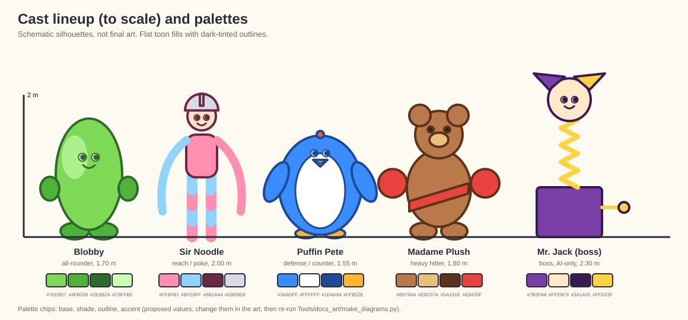
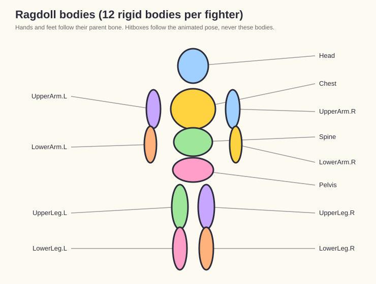

# characters.md — Fighters of WOBBLE BRAWL

> Companion to [`PRD.md`](PRD.md) (sections 4 and 14), [`architecture.md`](architecture.md) (sections 5 and 7) and [`coding_guidelines.md`](coding_guidelines.md) (section 9, Blender pipeline).
> The four-fighter cast, their personalities, moves and gimmicks are **approved by the owner**. Art style is **flat toon shading with outlines**. Fighters get **voice barks and SFX**. A **boss fighter** is required for Arcade Ladder. Numbers marked **(start)** are tuning defaults that live in `CharacterDef`/`MoveDef` data, never in code.
> These characters replace the robot models of the prototype (`Models/Characters/`).

## 1. Design Principles
1. **Floppy is the art style.** Each fighter is made of a material that looks funny when it bends, stretches, flattens or deflates. Ragdoll is not an effect added later; the character is designed for it.
2. **Readable silhouette.** A fighter must be recognizable as a flat black shape at phone size (about 2-3 cm tall on screen). Distinct head shape, limb length and one exaggerated feature each.
3. **Big, simple shapes.** Low-poly, smooth shading, few materials, bold colors. No thin parts that break in physics or disappear on a small screen.
4. **Readable limbs for combat.** Hands and feet are oversized so attacks and hitboxes are readable at a glance.
5. **Face carries emotion.** Simple, expressive faces (eyes and mouth swap via texture or blendshape): neutral, hurt, angry, dizzy (KO), happy (win).
6. **Fair differences.** Every fighter has one strength and one weakness (section 4). Differences come from data, not from hidden rules.
7. **Rig must survive ragdoll.** Consistent bone orientation, a clean hierarchy, and no bone chains that fight the physics joints (see section 3).

## 2. The Cast at a Glance

| | **Blobby** | **Sir Noodle** | **Puffin Pete** | **Madame Plush** |
|---|---|---|---|---|
| Concept | Jelly-bean person | Pool-noodle knight | Inflatable bouncy-castle penguin | Stitched teddy-bear boxer |
| Role | All-rounder / beginner-friendly | Reach / poke | Defense / counter | Heavy hitter |
| Gimmick | Bouncy; rebounds off walls | Very long limbs | Inflate for armor (can be popped) | Loses stuffing as she is hurt |
| Strength | Mobility, wall combos | Range | Tanky, hard to launch | High damage |
| Weakness | Low damage | Weak guard meter | Slow; popped = deflated and vulnerable | Slow, short reach |
| Floppiness (ragdoll) | 4/5 | 5/5 | 2/5 (stiff when inflated) | 3/5 |
| Skill level | Easy | Medium | Medium | Easy-Medium |
| Unlock | Default | Default | Coins | Coins |

*Schematic generated by `Tools/docs_art/make_diagrams.py` (to scale, not final art). Real concept art goes in the slots listed in the "Reference images" section.*

The **boss** (Mr. Jack, AI only) is described in section 4.5. Starter fighter: **Blobby** (built first, proves the Blender pipeline in M1; see [`task.md`](task.md) M1-11 to M1-14).

## 3. Shared Technical Specification
Authoritative budgets and conventions live in [`coding_guidelines.md`](coding_guidelines.md) section 9; summarized here.

| Item | Spec |
|---|---|
| Height | about 1.7-2.0 m, stylized; deviations listed per fighter |
| Triangles | <= 8-12k **(start)** |
| Bones | <= 30 deform bones, one armature, single root |
| Materials / textures | 1-2 materials, one 1024 atlas, mobile compression (ASTC) |
| Shading | **Flat toon shading with outlines** (section 3.4); no heavy transparency |
| Weights | normalized, max 4 influences per vertex |
| Animation | in place (no root motion), 60 FPS authored, loops close cleanly |
| Naming | `<Character>_<Part>_<Map>`, actions `<Character>_<Name>` (for example `Blobby_Punch1`) |
| Export | FBX/glTF via the Blender export script; validated by `Tools/Blender/validate_export.py` (task M1-13) |

### 3.1 Base rig
- Blobby, Madame Plush and (with changes) Sir Noodle share a **humanoid-ish base rig template** so animations can be reused or retargeted.
- Puffin Pete extends it with flipper and tail bones (not a Unity Humanoid: use **Generic** rig).
- Deviations from the template are documented in the character's folder (`README` next to the `.blend`).

### 3.2 Ragdoll bodies
About 12 rigid bodies per fighter, on these bones:

`Pelvis, Spine, Chest, Head, UpperArm.L/R, LowerArm.L/R, UpperLeg.L/R, LowerLeg.L/R` (hands and feet follow their parent).

- Collider shapes are simple capsules/boxes. Joint limits are set in Unity; bone twist axes must run along the bone.
- Each `CharacterDef` has `RagdollTuning`: mass scale, joint stiffness, drag, partial-ragdoll duration (0.2-0.6 s), full-ragdoll launch scale.
- **Hitboxes and hurtboxes follow the animated pose, never the ragdoll.** Ragdoll is visual feedback only.

*Ragdoll rigid bodies (schematic).*

### 3.3 Hurt zones (data)
`Head`, `Body`, `Legs`. The damage values per zone come from `MoveDef` (start: body 10, legs 5; see [`PRD.md`](PRD.md) 7.2). A fighter may override zone multipliers (for example Pete's armor).

### 3.4 Toon shading and outlines (decided)
- **Look:** flat colors with a 2-3 band toon ramp (lit / shade / rim), no smooth realistic gradients. Thick clean outlines on all fighters, props and key stage objects.
- **Outline method [VERIFY]:** an inverted-hull (back-face extruded) outline pass or a URP Renderer Feature, with a constant on-screen width. Pick the cheaper option on a mid-range Android phone (task M0-18).
- **Shared shader:** one URP toon shader (Shader Graph) used by every fighter, prop and stage so all assets match. Per-material parameters: base color, shade color, ramp thresholds, outline color and width, rim color. Skins only swap these parameters or the texture.
- **Texturing rule:** paint **flat, saturated colors with minimal baked lighting** (no baked shadows or ambient occlusion), and bold details (stitches, seams, rings). Faces are simple shapes.
- **Outline color:** a dark tint of the base color (not pure black) for a softer cartoon look; boss and special states may change outline color.
- **Budget:** the outline pass must not double the fighter cost on low-end devices; keep meshes simple, and provide a "low" quality tier that drops outlines to a cheaper method **[VERIFY]**.
- **Modeling note:** keep smoothing consistent so inverted-hull outlines do not break at hard edges (use averaged normals baked into a vertex channel if needed).

### 3.5 Required animation clips
Same list for everyone: idle, walk, jump (rise/fall/land), block (loop), punch 1-4, kick 1-2, special, throw item, hit-react light/heavy, guard break, knockdown, get-up, KO, win, taunt. Attack clips carry frame markers for hitbox enable/disable events.

## 4. Fighter Sheets

Stats are **(start)** values. The prototype baseline is HP 200, walk speed 3, jump force 10, damage 10/5/15.

### 4.1 Blobby (default fighter)
- **Concept:** a cheerful, translucent jelly-bean body with stubby limbs and a permanent grin. Looks like it could split in two.
- **Personality:** enthusiastic and clumsy. Taunt: wobbles and does a little shimmy. Win: bounces three times.
- **Silhouette:** bean-shaped torso, short thick limbs, large round hands and feet. Height about 1.7 m.
- **Concept art:** [turnaround sheet](images/characters/concept/blobby_turnaround.png) (approved style reference), [expressions](images/characters/concept/blobby_expressions.png), [key poses](images/characters/concept/blobby_poses.png) (sources in [`SOURCES.md`](images/characters/concept/SOURCES.md)).
- **Look:** glossy, semi-translucent look faked with a rim-light and a flat inner color (no real refraction on mobile). Default colors: lime green; skins: grape, strawberry, orange.
- **Gimmick, "Rebound":** when launched into a wall, Blobby bounces back and can act earlier than other fighters (wall-bounce combo extender, limited to one per combo).
- **Stats:** HP 200, speed 3.0, jump 10, guard meter 100, damage x1.0, reach x1.0.
- **Specials:** *Jelly Slam*: flattens into a puddle, then bounces up under the opponent (launcher, 15 damage). Gauge cost: full.
- **Move flavor:** punches with exaggerated stretch (arm lengthens on impact); kicks leave a squash smear.
- **Hit reactions:** big squash on impact, wobbles back to shape.
- **Blender notes:** squash/stretch via shape keys or a stretch-to rig on the spine; keep the mesh a single smooth shell. No inner geometry.
- **Sounds:** squelch, boing, giggle.

### 4.2 Sir Noodle
- **Concept:** a knight made of colored pool noodles, with a tin-pot helmet and a foam sword he rarely uses properly. Long, bendy limbs.
- **Personality:** pompous and dramatic. Taunt: bows with a flourish and bends all the way down. Win: noodle-bends into a heroic pose.
- **Silhouette:** tall (about 2.0 m), thin, extremely long arms and legs with segment rings.
- **Concept art:** [turnaround sheet](images/characters/concept/sir_noodle_turnaround.png), [expressions](images/characters/concept/sir_noodle_expressions.png), [key poses](images/characters/concept/sir_noodle_poses.png) (sources in [`SOURCES.md`](images/characters/concept/SOURCES.md)).
- **Look:** bright segmented pastel noodles (two-color alternating), foil helmet, cardboard shield.
- **Gimmick, "Long Reach":** attacks reach about 40% farther. His limbs ragdoll the most (floppiness 5/5).
- **Stats:** HP 170, speed 3.2, jump 10, guard meter 60 (weak), damage x0.9, reach x1.4.
- **Specials:** *Helicopter Joust*: spins like a propeller, hitting twice on each side; vulnerable during recovery.
- **Move flavor:** whip-like jabs, sweeping kicks, a lunging stab with the foam sword on punch 4.
- **Blender notes:** limbs are chains of 3-4 extra bones for the segmented bend; for ragdoll, **simplify to the standard 12 physics bodies** and drive the extra bones as follow bones (visual only). Height deviation: 2.0 m.
- **Sounds:** foam squeak, trumpet-like "huzzah".

### 4.3 Puffin Pete
- **Concept:** an inflatable bouncy-castle penguin with a visible valve on his back and a patch on one flipper.
- **Personality:** laid-back and gloating. Taunt: pats his belly like a drum. Win: slides on his belly.
- **Silhouette:** round, short (about 1.5-1.6 m), tiny feet, flippers instead of arms. Wide and low. Height deviation noted.
- **Concept art:** [turnaround sheet](images/characters/concept/puffin_pete_turnaround.png), [expressions](images/characters/concept/puffin_pete_expressions.png), [key poses](images/characters/concept/puffin_pete_poses.png) (sources in [`SOURCES.md`](images/characters/concept/SOURCES.md)).
- **Look:** primary-color vinyl with seam lines and a shine. Skins: pirate, astronaut, disco.
- **Gimmick, "Inflate":** while blocking at full guard he inflates: takes -30% damage and cannot be launched, but a "pop meter" fills when hit. If it fills, he **pops** and zips around deflating (a short helpless state, then refills to normal size). Gives a comeback and a risk.
- **Stats:** HP 220, speed 2.6, jump 8, guard meter 100, damage x1.0, reach x0.9.
- **Specials:** *Belly Blimp*: inflates hugely and bounces forward as a rolling bumper (wide hitbox, slow).
- **Move flavor:** belly bumps, flipper slaps, headbutts.
- **Blender notes:** inflate and deflate via shape keys; flipper and tail bones in addition to the base rig; Generic rig. Pop effect: swap to deflated mesh and spawn VFX (see [`vfx_style.md`](vfx_style.md)).
- **Sounds:** rubbery squeaks, air hiss, drum thump.

### 4.4 Madame Plush
- **Concept:** a worn teddy-bear boxer with patches, button eyes and a boxing sash. She loses cotton stuffing as the match goes on.
- **Personality:** tough but sweet. Taunt: fixes her stitches and cracks her knuckles. Win: holds the belt and hugs the camera.
- **Silhouette:** big head and large round boxing-glove paws, short legs. About 1.8 m.
- **Concept art:** [turnaround sheet](images/characters/concept/madame_plush_turnaround.png), [expressions](images/characters/concept/madame_plush_expressions.png), [key poses](images/characters/concept/madame_plush_poses.png) (sources in [`SOURCES.md`](images/characters/concept/SOURCES.md)).
- **Look:** brown fabric with visible stitches and mismatched patches. Skins: panda, polar bear, pink.
- **Gimmick, "Stuffing Loss":** at 75/50/25% health a seam opens and stuffing puffs out (VFX + mesh swap/shape key). Purely visual, except at 25% she gets a small damage bonus ("tough it out", +10% damage **(start)**).
- **Stats:** HP 240, speed 2.4, jump 9, guard meter 100, damage x1.2, reach x0.9.
- **Specials:** *Stitch Uppercut*: a huge slow wind-up uppercut that launches the opponent far (the biggest knockback).
- **Move flavor:** heavy hooks and cross punches; her kicks are just stubby stomps.
- **Blender notes:** stuffing via shape keys or a second mesh layer; fabric texture with stitches painted; use the base rig.
- **Sounds:** soft thud, creak of fabric, a sweet bell on win.

### 4.5 Mr. Jack (Boss, Arcade Ladder finale) [PROPOSED concept]
The owner confirmed a boss fighter is needed. The concept below is a proposal.
- **Concept:** a jack-in-the-box jester on a coiled spring, with a wide painted grin and a crank handle on his side.
- **Concept art:** [turnaround sheet](images/characters/concept/mr_jack_turnaround.png), [expressions](images/characters/concept/mr_jack_expressions.png), [key poses](images/characters/concept/mr_jack_poses.png) (sources in [`SOURCES.md`](images/characters/concept/SOURCES.md)).
- **Role:** final opponent of Arcade Ladder. **AI-only at launch (decided).** Making him playable is revisited after release; building his moves from `MoveDef` data keeps that option cheap.
- **Gimmick, two phases:**
  1. **In the box:** only his torso pops out; slow, heavy slams, a spring-loaded headbutt, and a lid-slam shockwave.
  2. **Out of the box (below 50% health):** he bursts out on his spring and becomes fast and bouncy, adding a corkscrew spring-dive and spinning-crank attacks.
- **Stats:** HP 320, speed 2.8, jump 12, guard meter 120, damage x1.1, reach x1.2 **(start)**. AI profile: aggressive, hard tier, uses the stage's items and hazards.
- **Special:** *Surprise!*: he vanishes into the box and pops out under the player with a loud sproing (telegraphed by a music-box tune and a ground marker).
- **Rig/ragdoll:** the spring is a chain of 4-6 bones driven by a spring simulation (visual); the 12-body ragdoll covers the jester torso and arms. Generic rig. Stage: Toy Chest Showdown ([`maps.md`](maps.md) 3.5).
- **Schedule fallback:** if time runs short, the boss becomes a recolored, buffed existing fighter on the boss stage, so Arcade Ladder can still ship (see [`PRD.md`](PRD.md) section 15.1 cut lines).

## Reference images
The lineup and ragdoll diagrams are generated schematics (proportions, relative heights, proposed palettes). They are regenerated with `python3 Tools/docs_art/make_diagrams.py`; the palette chips there are the **proposed** colors, so update the generator when the final colors are chosen.

**Ready-to-use prompts for generating this art are in [`art_prompts.md`](art_prompts.md).** **Concept art is provided by the owner** (task D-11). Put each file in `docs/images/characters/concept/` and link it from the fighter's sheet once it exists (the docs link check fails on missing files, so do not link a file before adding it). Suggested set per fighter:

| File | What it should show |
|---|---|
| `<name>_turnaround.png` | front, side and back views at the same scale, in the flat toon style with outlines |
| `<name>_expressions.png` | neutral, hurt, angry, dizzy (KO) and happy (win) faces |
| `<name>_poses.png` | idle, a punch, a kick, block, knockdown and win poses (key poses for the animator) |
| `<name>_silhouette.png` | solid black silhouette at phone size, to check readability |
| `<name>_materials.png` | material and color callouts (base, shade, outline, accent) |
| `<name>_moodboard.png` | 4-8 references for the material (jelly, pool noodle, vinyl, plush fabric) |

Names: `blobby`, `sir_noodle`, `puffin_pete`, `madame_plush`, `mr_jack`. Rules: record the source and license of anything you did not create (`SOURCES.md` next to the images), save them as PNG at least 2048 px wide (upscaled downloads are fine because these are references for Blender modeling), and keep each file under about 5 MB (they are stored directly in the repo, not in Git LFS). The Blender models (tasks M1-11, M4-01 to M4-03, M4-10) should be built from these sheets.

## 5. Costumes (Skins)
- A skin is a **material/texture swap**, optionally with an accessory prefab (hat, bandana). It never changes stats or hitboxes.
- Unlock via coins or purchase (see [`PRD.md`](PRD.md) section 12). Cosmetic only (no pay-to-win).
- Each fighter ships with 1 default + 3 skins at launch **(start)**. Skins are data (`CostumeDef`).
- Texture atlas stays at 1024 per skin; share the mesh.

## 6. Voice and Sound
**Decided:** fighters have both **voice barks and SFX**, applied where it fits the character.

| Fighter | Voice | SFX |
|---|---|---|
| Blobby | giggles, "wheee", gibberish babble | squelch, boing |
| Sir Noodle | proud, dramatic English-ish barks ("huzzah!", "have at thee!") | foam squeak |
| Puffin Pete | a few lazy grunts and chuckles | rubbery squeaks, air hiss, drum thump |
| Madame Plush | sweet but tough barks ("take that, dear!") | fabric creak, soft thud |
| Mr. Jack (boss) | cackling jester laughs, taunts | spring "sproing", music-box notes |
| Announcer | cartoonish announcer ("FIGHT!", "K.O.!", "Round two!") | none |

- Voice events: attack shout (1-2 variants per move tier), hit grunt (light/heavy), KO cry, win line, taunt, round start. A **single short clip** per event (0.2-1.0 s) with 2-3 random variants to avoid repetition.
- Barks are throttled (no more than one voice clip every 0.4 s per fighter) and never cover the announcer.
- Voice volume has its own bus and setting, and can be turned off in settings.
- Mobile budget: mono, compressed (Vorbis/ADPCM), short clips only; total voice audio about 5 MB at launch **(start)**.
- **Voice source (decided): VoxCPM2**, an open-source text-to-speech model, generates the barks and announcer lines. The pipeline:
  1. A clip list (`Tools/Audio/voice_lines.json`: id, fighter, line text, style note, variants).
  2. A generation script that renders each line with VoxCPM2 and writes WAVs to a staging folder (not imported directly).
  3. Manual edit pass: trim, normalize, pitch/formant and effects (for example springs, squeaks, foam) per character, then compress for mobile.
  4. A per-clip record: line id, model name and version, settings, seed, date and license note.
- **Verify before relying on it [VERIFY] (task D-08):** the model's code and weights licenses (commercial use, attribution), the rights to the generated output, the hardware needed to run it (GPU or CPU, speed), and Google Play's policy on AI-generated content.
- **Quality caveats [VERIFY]:** text-to-speech is best at spoken words and short phrases. Grunts, giggles, screams and non-word sounds may come out poorly, so those are made with SFX, pitch-shifted human sounds, or simple synthesis instead. Judge a sample before committing to the full clip list.
- **No voice cloning of real people** without their written permission. Use invented or neutral voice settings.
- Keep the generation script and clip list in the repo so clips can be regenerated; do not commit the model weights (large, separate license).
- No dialogue or story voice acting: only short barks and the announcer.

## 7. Taunts and Emotes
- One taunt per fighter at launch. Taunts play at round start (skippable) and as a button in Versus modes.
- Online emotes are limited to a fixed set (no free text). See [`architecture.md`](architecture.md) section 19.

## 8. Production Checklist (per fighter)
1. Concept sketch + silhouette test (is it readable as a black shape?)
2. Blockout in Blender at correct scale (1 unit = 1 m)
3. Final mesh within budget, UVs, materials
4. Texturing (atlas), faces/expressions
5. Rig on the base rig template (deviations documented), weights checked with extreme poses
6. Squash/stretch and shape keys (where used)
7. Animation set (section 3.5), looped and in place
8. Run `validate_export.py`, export to `Art/Characters/<Name>/`
9. Unity import: rig type, avatar mask, compression
10. Create `CharacterDef` + `MoveDef` assets; wire hitboxes via animation events
11. Ragdoll setup (12 bodies) and tuning (`RagdollTuning`)
12. Voice barks and SFX recorded/sourced, licensed and hooked to events
13. Playtest: readability on a phone, fairness vs. the other fighters, 60 FPS with two fighters on screen

## 9. Balance Rules
- Compare fighters with **data only**. Never special-case a fighter in code.
- Total "power budget" (damage x speed x reach x health) should be similar between fighters; gimmicks should be the tiebreaker.
- Review balance after each new fighter, based on AI-vs-AI simulation (`Sandbox_Match`) and playtests.

## 10. Decisions & Open Questions

**Decided by the owner:**
1. Art style: flat toon shading with outlines (section 3.4).
2. The personality and move concepts and gimmicks above are approved.
3. Voice barks and SFX, where applicable (section 6).
4. A boss fighter is needed for Arcade Ladder (section 4.5).

**Also decided:**
5. Voice audio is generated with the open-source VoxCPM2 model (section 6).
6. Mr. Jack is AI-only at launch.

**Still open [OPEN]:**
1. VoxCPM2 license, output rights, hardware needs and clip quality (task D-08).
2. Boss concept sign-off (Mr. Jack's look, moves and phases).
