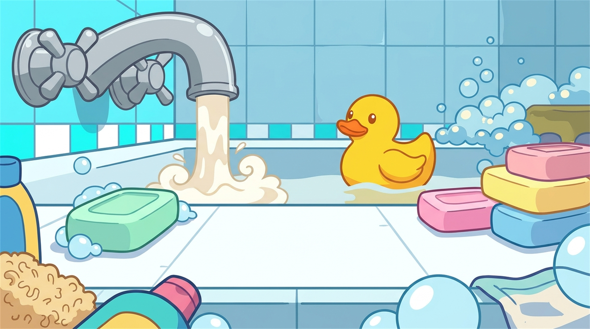
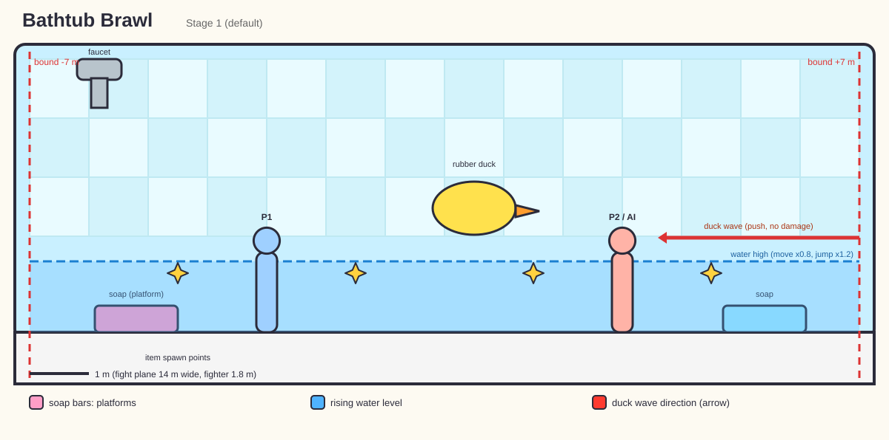
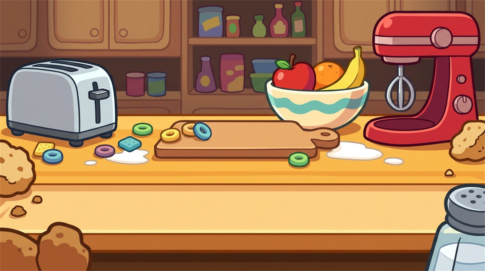
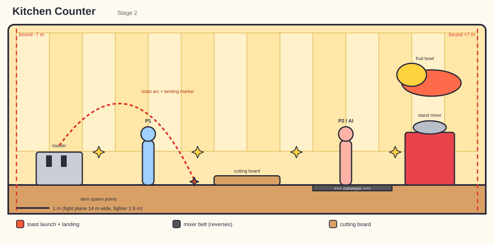
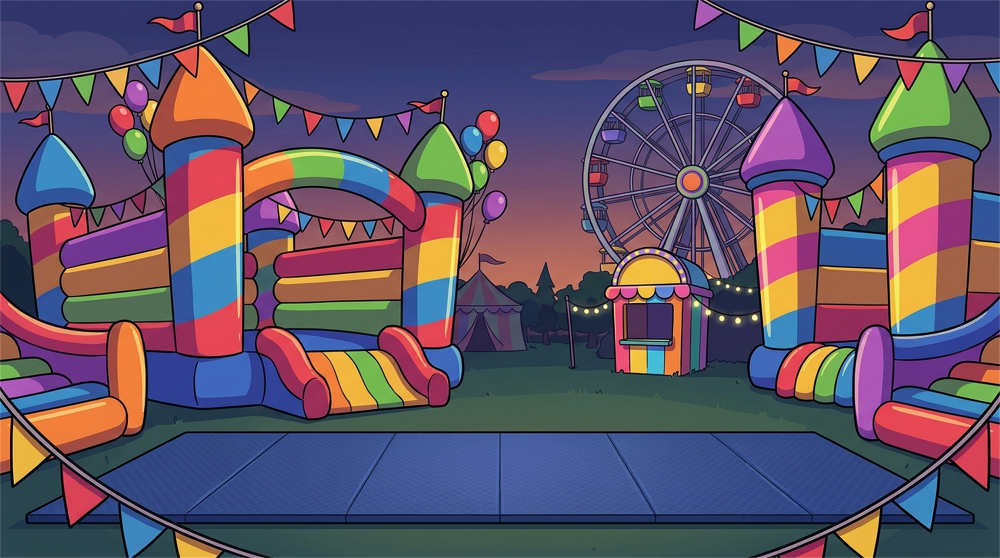
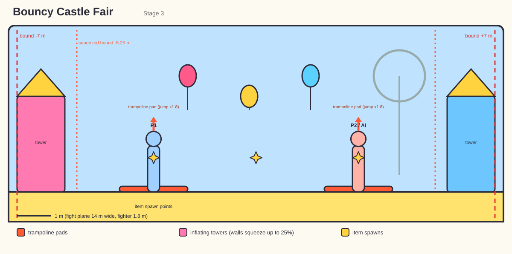
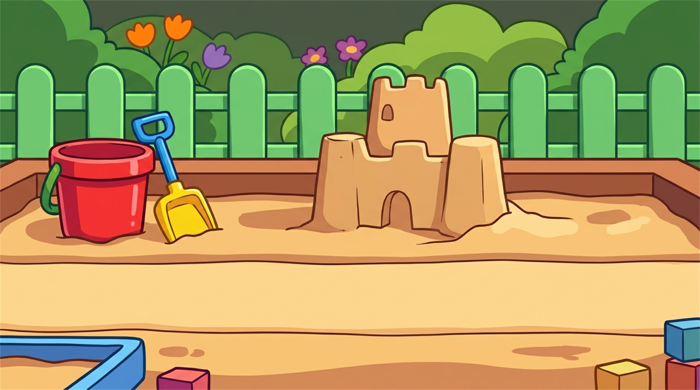
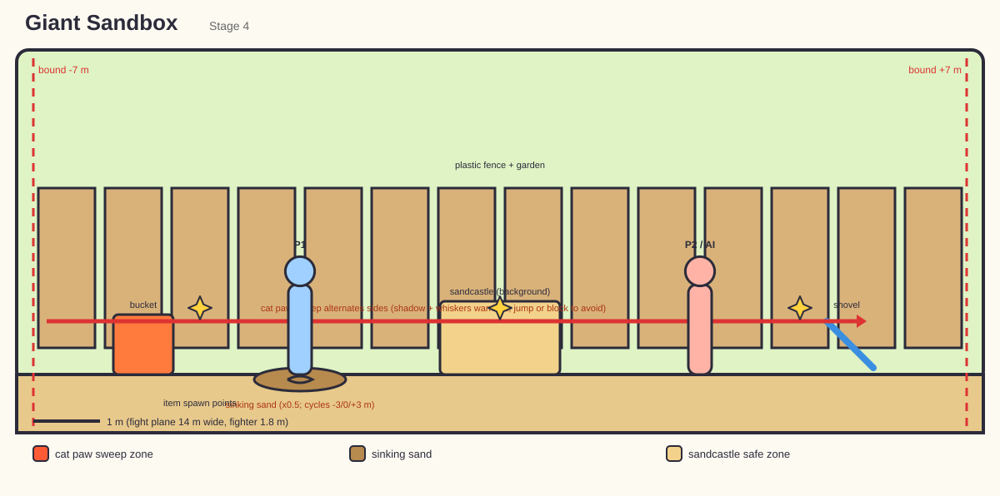
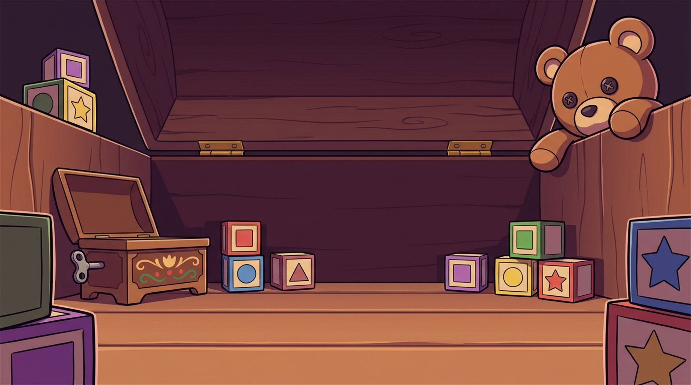
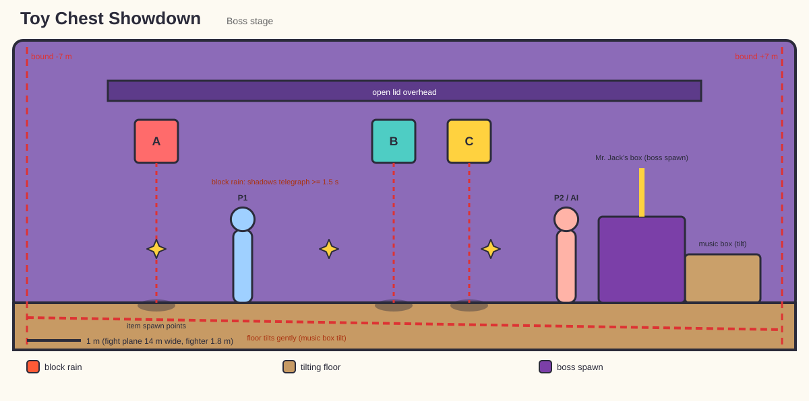

# maps.md — Stages (Maps)

> Companion to [`PRD.md`](PRD.md) (section 9), [`architecture.md`](architecture.md) (section 8.2-8.3), [`vfx_style.md`](vfx_style.md) and [`characters.md`](characters.md).
> The four launch stages, their themes and hazards are **approved by the owner**, and a **boss stage** is required for Arcade Ladder. All stages use the **flat toon + outline** style ([`characters.md`](characters.md) 3.4). Boss-stage details are a **[PROPOSED]** concept. Numbers marked **(start)** are tuning defaults stored in `StageDef`/`HazardDef` data.
> The prototype's single arena (`BattleScene 1/2`: floor, walls, three directional lights) becomes a reusable **Match scene** that loads whichever stage is selected.

## 1. Stage Design Rules
1. **A stage is a flat fight plane.** Fighters move on the X axis (2.5D); Z is locked. The plane is clear and readable; decoration lives in the foreground/background.
2. **Fair chaos.** One hazard at a time per stage (two on larger stages, never overlapping their active windows). Every hazard is telegraphed for **>= 1.5 s (start)** and can be avoided or exploited.
3. **Silhouettes first.** The background must never visually blend with the fighters: darker or lower-saturation backdrops, bright characters.
4. **Toy-box scale.** Each stage is a real-world place seen from a toy's point of view (a bathtub, a kitchen counter...), with giant props.
5. **Cheap to render.** Baked lighting where possible, modular props, one shared atlas per stage, shadows limited to the fighters (blob or single light).
6. **Everything is data.** Layout, hazards, item points, camera bounds and music come from `StageDef`; adding a stage needs no new code, only art and data.

## 2. Shared Technical Spec

| Item | Spec (start) |
|---|---|
| Fight plane width | **about 14 m** between the side bounds (decided; the prototype arena measures about 13-14 m from its scene file, so confirm in Unity). If fighters look too small when far apart on a phone, **shrink the camera bounds** instead of rebuilding stages. |
| Fight plane height | ceiling and jump height **[VERIFY]**: the prototype's jump force of 10 should give an apex of about 5 m with default gravity, which does not match the 3 m / 6 m assumption. Measure in Unity and set jump height, gravity and ceiling as data (task M0-19). |
| Bounds | invisible walls + camera bounds; fighters cannot leave; wall-bounce only where stated (Blobby) |
| Scene budget | <= 100k tris visible, <= 150 draw calls total, 1 atlas per stage |
| Lighting | baked GI + a main directional light; no per-pixel extra lights on mobile **[VERIFY with URP settings]** |
| Camera | `FightCamera` (see [`architecture.md`](architecture.md) 11): frames both fighters, clamps to bounds, min distance 3 |
| Item spawn points | 3-5 marked points from `StageDef`, deterministic seeded spawner |
| Layers | `Environment` (floor/walls), `Hazard`, `Item`; see [`architecture.md`](architecture.md) 6.1 |
| Audio | one music track + one ambient loop per stage, SFX per hazard |
| Thumbnail | 16:9 render for the stage select screen |

### 2.1 Hazard cycle (all stages)
`Idle (random 8-14 s) -> Telegraph (>= 1.5 s) -> Active (2-4 s) -> Cooldown`

- Hazard timing is seeded from the match seed for reproducible tests.
- The first hazard never fires before **15 s (start)** into a round, and never in sudden death unless the stage says so.
- Hazard damage and status effects go through the normal `HitInfo` pipeline.
- CombatSandbox has a test zone at center stage. The yellow warning starts after 15 seconds, lasts two seconds, and is followed by two seconds of orange activation. The test hit uses 12 base damage and 5 m/s knockback.

Normal arenas append the six M4-06 pickup definitions through the installed item catalog, bringing weighted spawning to all twelve. Authored stage points/timers stay unchanged. CombatSandbox preserves the original opening lineup; NewItemSandbox is a separate hazard-free fixture for the six additions. See [items.md](items.md).

## 3. Launch Stages

### 3.1 Bathtub Brawl (Stage 1, default)
- **Setting:** a giant tub: porcelain floor and walls, soap bars, a rubber duck, bubbles, a faucet and tiles in the background.
- **Mood / palette:** bright cyan, white and yellow; soft and clean.
- **Rendering:** Opaque props, including the faucet, use the stage toon palette. The rising water and duck wave use a transparent toon shader so fighters remain visible through them.
- **Concept art:** color key (sources in [`SOURCES.md`](images/maps/concept/SOURCES.md)):

  
- **Layout (to-scale side view of the fight plane):**

  

  *Schematic generated by `Tools/docs_art/make_diagrams.py` (to scale, not final art). Real concept art goes in the slots listed in the "Reference images" section.*
- **Hazards:**
  - **Rising Water:** after a two-second drip and waterline warning, water rises to 1.2 m over three seconds, holds for one second, and drains over the two-second cooldown. Wet fighters move at 0.8× speed and launch jumps at 1.2× speed. Their ragdoll bodies use 0.55× gravity. A fighter becomes dry when their feet clear the waterline. The soap platforms are 0.45 m tall and can still be submerged at peak water.
  - **Rubber Duck Wave:** alternates with Rising Water. A duck shadow, left-pointing chevron, and quack warn for two seconds. The duck and wave cross from right to left over 3.4 seconds. The wave pushes fighters without damage once per pass. Jump above the 0.65 m crest to avoid it.
- **Items:** spawn on soap bars and floor; slippery soap makes the banana peel feel at home. The combat pickup art borrows the rounded toy shapes and saturated colors from the Bathtub Brawl and Kitchen Counter color keys.
- **Ambient:** floating bubbles (low count), drip sounds.
- **Music:** lighthearted ukulele and bubble pops.
- **Unlock:** default.

### 3.2 Kitchen Counter (Stage 2)
- **Setting:** a giant countertop: a cutting board, a toaster, a stand mixer, spilled cereal and a fruit bowl in the background.
- **Mood / palette:** warm yellow, red and wood tones.
- **Rendering:** The full arena, including the toaster shell, mixer trim, and hazard markers, uses the opaque toon palette.
- **Concept art:** color key (sources in [`SOURCES.md`](images/maps/concept/SOURCES.md)):

  
- **Layout (to-scale side view of the fight plane):**

  

  *Schematic generated by `Tools/docs_art/make_diagrams.py` (to scale, not final art). Real concept art goes in the slots listed in the "Reference images" section.*
- **Hazards:**
  - **Toast Launch:** after a two-second warning with red coils, ticking, and floor crosses, two slices fly in staggered arcs. An unblocked hit deals 10 base damage and 2.6 m/s knockback. Each fighter can be hit once per launch. Reusable toast remains a proposed variant.
  - **Mixer Belt:** alternates with Toast Launch. Direction arrows and a whir warn for two seconds. The belt adds 2.3 m/s sideways speed to grounded movement on the tread, reverses every 1.8 seconds during its four-second activation, and deals no damage.
- **Items:** spawn near the cutting board; a rolling pin-style foam glove variant is possible.
- **Ambient:** steam puffs, crumb particles, faint kitchen clatter.
- **Music:** upbeat funk with percussion on pans.
- **Unlock:** default or first coin unlock **(start: default)**.

### 3.3 Bouncy Castle Fair (Stage 3)
- **Setting:** an inflatable castle on a fairground: striped towers, flag bunting, balloons and a ticket booth in the background.
- **Mood / palette:** vivid primaries with party lights; playful and loud.
- **Concept art:** color key (sources in [`SOURCES.md`](images/maps/concept/SOURCES.md)):

  
- **Layout (to-scale side view of the fight plane):**

  

  *Schematic generated by `Tools/docs_art/make_diagrams.py` (to scale, not final art). Real concept art goes in the slots listed in the "Reference images" section.*
- **Hazards:**
  - **Trampoline Pads:** two 2 m-wide floor sections at X -3/+3 m launch grounded fighters at 1.8 times normal jump speed. Standing, walking or landing on an active pad auto-bounces; jumping on activation receives the same boost. Upward or high airborne fighters are not re-launched. *Telegraph:* upward warning arrows pulse at 1.5 Hz with a chime for two seconds. Pads stay active four seconds; a boing marks each bounce. *Counterplay:* use them for aerial attacks, or avoid them to stay grounded.
  - **Wall Squeeze:** kinematic side walls shrink inner bounds from X ±7 to ±5.25 m (25% width reduction **(start)**): one second inward, two seconds held, one second outward. *Telegraph:* inward arrows, pulsing visual bulges and a pump/creak sound warn for two seconds. *Effect:* fighters are contained even during boosted jumps/hit-stop; camera framing follows the width and keeps high bounces visible. No damage. The camera yields to KO presentation.
- **Items:** three seeded spawn points at X -3/0/+3 m, on pads and the center floor; accessible at minimum width. Standard pooled spawning, with one opening pickup and no six-item testing lineup.
- **Ambient:** floating balloons, fair lights, distant carnival noise.
- **Music:** circus/carnival with a funky beat.
- **Interplay:** Puffin Pete is thematically at home here (a nod, not a rule).
- **M4-04 implementation:** [original source, budgets and import notes](../Art/_Source/BouncyCastleFair/README.md). Three Blender meshes, one 1024 atlas, shared toon graph and outline, original carnival music/ambient/warning cues, and a selection thumbnail. Hazards alternate from pads after a 15 s opening delay, using four-second active windows, two-second cooldowns and seeded 8–14 s idles. Round boundaries, sudden death and Hazards Off clear warnings/audio/boosts and restore full width. Boot discovers the stage resource automatically; coin unlock gating is M4-08, so it is available for content testing. Native Unity/Android verification remains pending.
- **Unlock:** coins.

### 3.4 Giant Sandbox (Stage 4)
- **Setting:** a sandbox in a backyard: toy shovels and buckets, a half-built sandcastle and a plastic fence in the background, grass at the edges.
- **Mood / palette:** warm sand, bright toy plastics and green.
- **Concept art:** color key (sources in [`SOURCES.md`](images/maps/concept/SOURCES.md)):

  
- **Layout (to-scale side view of the fight plane):**

  

  *Schematic generated by `Tools/docs_art/make_diagrams.py` (to scale, not final art). Real concept art goes in the slots listed in the "Reference images" section.*
- **Hazards:**
  - **Cat Paw Sweep:** a giant cat paw (or tail) sweeps across the stage from one side. *Telegraph:* a big shadow creeps in and whiskers twitch at the edge, with a purr/hiss sound. *Effect:* knocks fighters down (no damage) unless they jump or block; safe zone behind the sandcastle **[PROPOSED]**.
  - **Sinking Sand:** one 2.7 m-wide patch at X -3, 0 or +3 m cycles each sand turn. *Telegraph:* the spiral pulses for two seconds with a sandy swirl cue. *Effect:* grounded movement x0.5 for four seconds; leaving or jumping clear restores full speed. No damage or jump/knockback changes.
- **Items:** three seeded pooled spawn points at X -4.5/0/+4.5 m, near the toy props and center. One opening pickup; no six-item testing lineup.
- **Ambient:** blowing sand particles (subtle), insects, distant dog barks.
- **Music:** playful acoustic guitar with bongos.
- **M4-05 implementation:** [original source, budgets and import notes](../Art/_Source/GiantSandbox/README.md). Five Blender meshes, one packed 1024 atlas, shared toon graph/navy outline, selection thumbnail and original plucked-string/bongo, ambience and hazard audio. The paw warns with an approaching shadow, twitching whiskers and purr for two seconds, then sweeps between ±8.5 m over three seconds within a four-second active window. It alternates entry sides, hits once per fighter, uses zero damage/guard cost, 3.5 m/s pushback and an authored 30-frame knockdown (shared combo stun cap applies), followed by GetUp/wake-up protection. Block avoids it completely; feet at/above 0.85 m clear it. The castle remains background decoration; the proposed safe zone is not active. Paw and sand alternate after a 15 s opening delay, with two-second cooldowns and seeded 8–14 s idles. Round boundaries, sudden death and Hazards Off clear meshes/audio/slowdown. Physical bounds retain fighters at ±7 m. Boot discovers the stage automatically; coin unlock gating remains M4-08. Native Unity and Android checks are pending.
- **Unlock:** coins.

### 3.5 Toy Chest Showdown (Boss Stage, Arcade finale) [PROPOSED concept]
- **Setting:** inside a giant open toy chest: a wooden floor, alphabet blocks, a teddy peeking over the edge, the lid propped open overhead, and a music box in the corner (Mr. Jack's lair).
- **Mood / palette:** deeper, warmer purple and wood tones with bright toy accents, so the boss and fighters pop.
- **Concept art:** color key (sources in [`SOURCES.md`](images/maps/concept/SOURCES.md)):

  
- **Layout (to-scale side view of the fight plane):**

  

  *Schematic generated by `Tools/docs_art/make_diagrams.py` (to scale, not final art). Real concept art goes in the slots listed in the "Reference images" section.*
- **Hazards (two, never active together):**
  - **Block Rain:** alphabet blocks fall from above at marked spots. *Telegraph:* round shadows grow on the floor and a rattle sound plays for >= 1.5 s. *Effect:* 10 damage and a bounce on hit **(start)**; blocks stay for a few seconds as small obstacles, then vanish.
  - **Music Box Tilt:** the music box plays a slowing tune and the floor tilts gently one way (fighters slide). *Telegraph:* tune slows and the chest creaks. *Effect:* slide only, no damage.
- **Boss integration:** the boss's *Surprise!* special and the lid-slam shockwave use the stage's ground-marker VFX. In phase 2 the music speeds up.
- **Items:** spawn at 3 fixed points; the item table favors defensive and healing-style items for the finale **[OPEN]**.
- **Ambient:** floating dust in a light beam, quiet music-box notes.
- **Music:** a creepy-cute music-box theme that gets louder and faster in phase 2.
- **Unlock:** only in Arcade Ladder at launch (Versus availability is **[OPEN]**).
- **Fallback:** if time runs short, reuse an existing stage with a recolor and a boss-specific hazard.

## Reference images
The layout diagrams above are generated schematics showing the 14 m fight plane, bounds, fighter scale (1.8 m), item spawn points and hazard zones. They are regenerated with `python3 Tools/docs_art/make_diagrams.py` when layout numbers change.

**Ready-to-use prompts for generating this art are in [`art_prompts.md`](art_prompts.md).** **Concept art is provided by the owner** (task D-11), lives in `docs/images/maps/concept/` and is embedded in each stage's section above. Provenance for every image is in [`SOURCES.md`](images/maps/concept/SOURCES.md). Core set (checked by `Tools/tasks/check_concept_art.py`):

| Stage | Color key | Status |
|---|---|---|
| Bathtub Brawl | [`bathtub_brawl_colorkey.png`](images/maps/concept/bathtub_brawl_colorkey.png) | supplied |
| Kitchen Counter | [`kitchen_counter_colorkey.png`](images/maps/concept/kitchen_counter_colorkey.png) | supplied |
| Bouncy Castle Fair | [`bouncy_castle_fair_colorkey.png`](images/maps/concept/bouncy_castle_fair_colorkey.png) | supplied |
| Giant Sandbox | [`giant_sandbox_colorkey.png`](images/maps/concept/giant_sandbox_colorkey.png) | supplied |
| Toy Chest Showdown | [`toy_chest_showdown_colorkey.png`](images/maps/concept/toy_chest_showdown_colorkey.png) | supplied |

Optional extras per stage, **not yet supplied**: `<stage>_moodboard.png` (4-8 reference photos/illustrations, e.g. toy-scale bathtub, soap, rubber duck for Bathtub Brawl).

Rules for reference images: record the source and license of anything you did not create (a `SOURCES.md` next to the images), prefer your own art or properly licensed images, save them as PNG at least 2048 px wide, and keep each file under about 5 MB (they are stored directly in the repo, not in Git LFS).

## 4. Stage Data (`StageDef`)
Per [`architecture.md`](architecture.md) 8.3, each stage defines:
- Id, display name, thumbnail, scene/prefab reference
- Fighter spawn points (left/right) and side bounds
- Camera bounds and default distance
- Item spawn points and the weighted item table
- Hazard list (each a `HazardDef`: telegraph time, active time, cooldown, effect, VFX/SFX ids)
- Music and ambient ids
- Unlock requirement

`HazardDef` fields: `Id, TelegraphTime, ActiveTime, Cooldown, StartDelay, Effect, Vfx/SfxIds, Seeded`.

## 5. Stage Selection & Rules
- Stage select shows thumbnail, name and a one-line hazard hint. **Random** is an option.
- Arcade Ladder fixes the stage order: Bathtub -> Kitchen -> Castle -> Sandbox -> **Toy Chest Showdown (boss)**.
- Online matches (post-launch) choose a stage by agreement or random; hazard timing comes from the shared seed (see [`architecture.md`](architecture.md) 19).
- **Classic options (decided, at launch):** two separate toggles in match setup, **Hazards on/off** and **Items on/off**. With both off the match is pure fighting. Defaults: both on.
  - They are match rules (`MatchRules`: `HazardsEnabled`, `ItemsEnabled`) read by `HazardController` and `ItemSpawner`, not per-stage code.
  - Turning hazards off also disables the telegraph VFX/SFX and the hazard timers. Stage art and ambient effects stay.
  - Boss stage and Arcade Ladder always use hazards and items on (the boss fight is designed around them).
  - Both toggles are part of the match setup so online matches can use the same rules (see [`architecture.md`](architecture.md) section 19).
  - The controls appear on Boot's Quick Fight arena selection. Rematch retains their settings; a fresh selection resets them to on. Direct scene testing keeps both on. Future boss entries set `StageChoice.IsBossStage` and the scene's `MatchController.isBossStage`; Arcade selection uses `MatchMode.Arcade`. Those entries show checked, disabled options. Stage content and Arcade progression remain M4 tasks.

## 6. Production Checklist (per stage)
1. Concept + layout sketch; confirm width, bounds and item points
2. Modular props blockout; check scale against fighters
3. Textures/atlas (one per stage); URP materials
4. Baked lighting; background layers; ambient particles
5. Hazard(s) built as data + prefab; telegraph, active and cooldown timing tested
6. VFX and SFX bound (see [`vfx_style.md`](vfx_style.md))
7. Camera bounds tested with all fighters (Sir Noodle's reach, Puffin's size)
8. Performance test on a low-end phone (draw calls, overdraw, particles)
9. Playtest for fairness (can every hazard be seen and avoided?)

## 7. Post-launch Stage Ideas [OPEN]
- Laundromat (spin-cycle drum hazard), Toy Train Tracks (passing train), Birthday Cake (candle fire hazard), Mini Golf, Treehouse.

## 8. Decisions & Open Questions

**Decided by the owner:**
1. The four launch stages, their themes and their hazards are approved.
2. A boss stage is needed for Arcade Ladder (section 3.5).

**Also decided:**
3. Classic mode is included at launch as separate Hazards on/off and Items on/off toggles (section 5).
4. Fight-plane width is about 14 m for now; adjust camera bounds if needed.

**Still open [OPEN]:**
1. Measure the prototype arena and jump in Unity and confirm width, ceiling and jump height (task M0-19).
2. Is the boss stage playable in Versus after launch?
