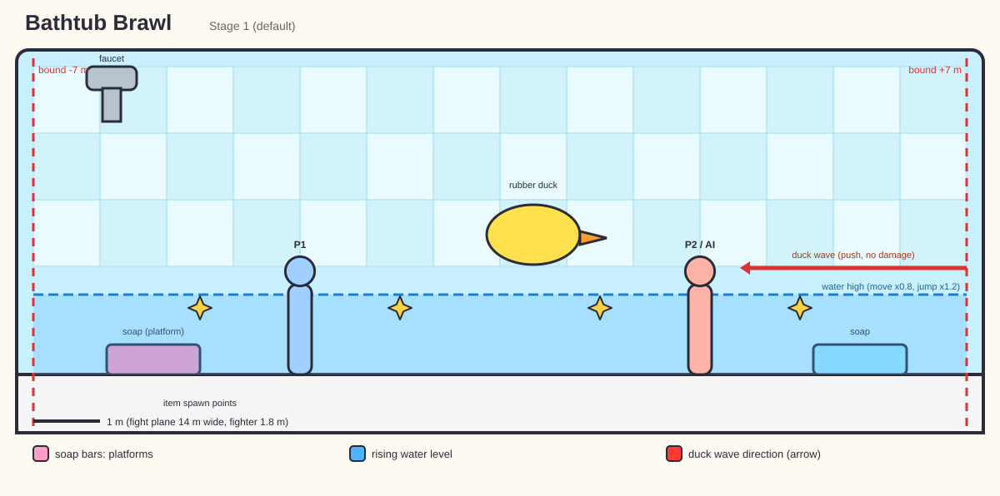
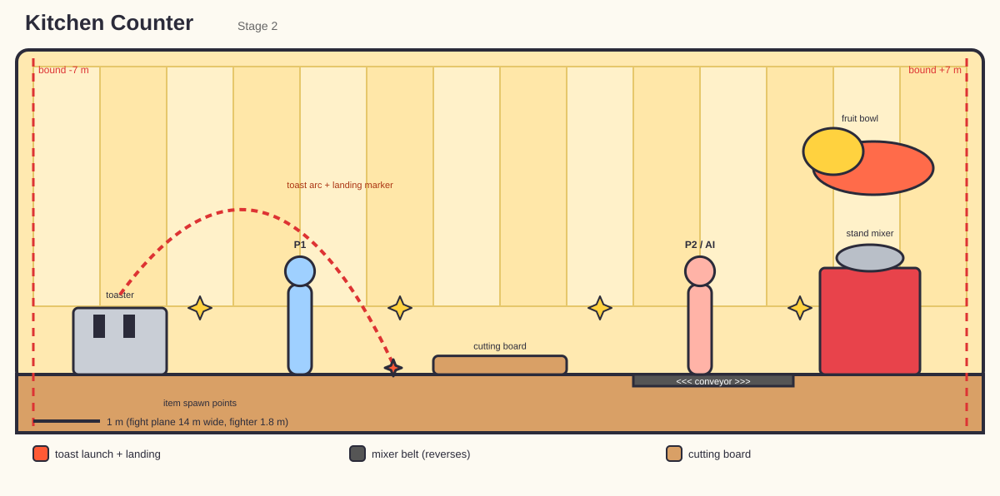
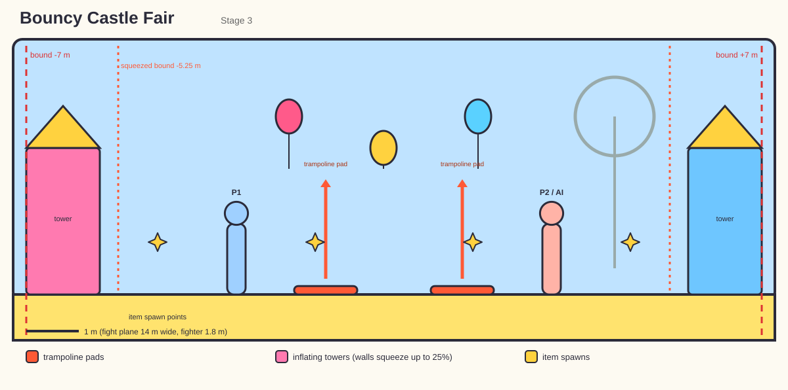
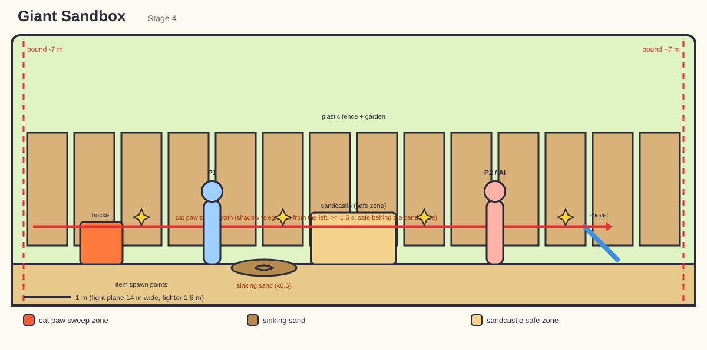
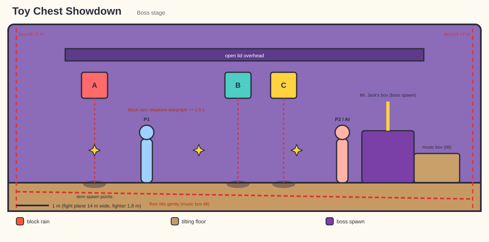

# maps.md — Stages (Maps)

> Companion to [`PRD.md`](PRD.md) (section 9), [`architecture.md`](architecture.md) (section 8.2-8.3), [`vfx_style.md`](vfx_style.md) and [`characters.md`](characters.md).
> The four launch stages, their themes and hazards are **approved by the owner**, and a **boss stage** is required for Arcade Ladder. All stages use the **flat toon + outline** style ([`characters.md`](characters.md) 3.4). Boss-stage details are a **[PROPOSED]** concept. Numbers marked **(start)** are tuning defaults stored in `StageDef`/`HazardDef` data.
> The prototype's single arena (`BattleScene 1/2`: floor, walls, three directional lights) becomes a reusable **Match scene** that loads whichever stage is selected.

## 1. Stage Design Rules
1. **A stage is a flat fight plane.** Fighters move on the X axis (2.5D); Z is locked. The plane is clear and readable; decoration lives in the foreground/background.
2. **Fair chaos.** One hazard at a time per stage (two on larger stages, never overlapping their active windows). Every hazard is telegraphed for **>= 1.5 s (start)** and can be avoided or exploited.
3. **Silhouettes first.** The background must never visually blend with the fighters: darker or lower-saturation backdrops, bright characters.
4. **Toy-box scale.** Each stage is a real-world place seen from a toy's point of view (a bathtub, a kitchen counter...), with giant props.
5. **Cheap to render.** Baked lighting where possible, modular props, one shared atlas per stage, shadows limited to the fighters (blob or single light).
6. **Everything is data.** Layout, hazards, item points, camera bounds and music come from `StageDef`; adding a stage needs no new code, only art and data.

## 2. Shared Technical Spec

| Item | Spec (start) |
|---|---|
| Fight plane width | **about 14 m** between the side bounds (decided; the prototype arena measures about 13-14 m from its scene file, so confirm in Unity). If fighters look too small when far apart on a phone, **shrink the camera bounds** instead of rebuilding stages. |
| Fight plane height | ceiling and jump height **[VERIFY]**: the prototype's jump force of 10 should give an apex of about 5 m with default gravity, which does not match the 3 m / 6 m assumption. Measure in Unity and set jump height, gravity and ceiling as data (task M0-19). |
| Bounds | invisible walls + camera bounds; fighters cannot leave; wall-bounce only where stated (Blobby) |
| Scene budget | <= 100k tris visible, <= 150 draw calls total, 1 atlas per stage |
| Lighting | baked GI + a main directional light; no per-pixel extra lights on mobile **[VERIFY with URP settings]** |
| Camera | `FightCamera` (see [`architecture.md`](architecture.md) 11): frames both fighters, clamps to bounds, min distance 3 |
| Item spawn points | 3-5 marked points from `StageDef`, deterministic seeded spawner |
| Layers | `Environment` (floor/walls), `Hazard`, `Item`; see [`architecture.md`](architecture.md) 6.1 |
| Audio | one music track + one ambient loop per stage, SFX per hazard |
| Thumbnail | 16:9 render for the stage select screen |

### 2.1 Hazard cycle (all stages)
`Idle (random 8-14 s) -> Telegraph (>= 1.5 s) -> Active (2-4 s) -> Cooldown`

- Hazard timing is seeded from the match seed for reproducible tests.
- The first hazard never fires before **15 s (start)** into a round, and never in sudden death unless the stage says so.
- Hazard damage and status effects go through the normal `HitInfo` pipeline.

## 3. Launch Stages

### 3.1 Bathtub Brawl (Stage 1, default)
- **Setting:** a giant tub: porcelain floor and walls, soap bars, a rubber duck, bubbles, a faucet and tiles in the background.
- **Mood / palette:** bright cyan, white and yellow; soft and clean.
- **Concept art:** [color key](images/maps/concept/bathtub_brawl_colorkey.png) (sources in [`SOURCES.md`](images/maps/concept/SOURCES.md)).
- **Layout (to-scale side view of the fight plane):**

  

  *Schematic generated by `Tools/docs_art/make_diagrams.py` (to scale, not final art). Real concept art goes in the slots listed in the "Reference images" section.*
- **Hazards:**
  - **Rising Water:** the water level rises over about 3 s and then drains. While water is high: movement x0.8, jump height x1.2, floaty ragdoll. *Telegraph:* the faucet drips and rattles, a blue wave line on the wall. *Counterplay:* fight on the soap bars (platforms) to stay dry **[PROPOSED]**.
  - **Rubber Duck Wave:** a giant duck floats across the back and sends a wave from one side. *Telegraph:* duck shadow and a "quack" sound from the incoming side. *Effect:* pushes fighters (knockback, no damage) **(start)**.
- **Items:** spawn on soap bars and floor; slippery soap makes the banana peel feel at home.
- **Ambient:** floating bubbles (low count), drip sounds.
- **Music:** lighthearted ukulele and bubble pops.
- **Unlock:** default.

### 3.2 Kitchen Counter (Stage 2)
- **Setting:** a giant countertop: a cutting board, a toaster, a stand mixer, spilled cereal and a fruit bowl in the background.
- **Mood / palette:** warm yellow, red and wood tones.
- **Concept art:** [color key](images/maps/concept/kitchen_counter_colorkey.png) (sources in [`SOURCES.md`](images/maps/concept/SOURCES.md)).
- **Layout (to-scale side view of the fight plane):**

  

  *Schematic generated by `Tools/docs_art/make_diagrams.py` (to scale, not final art). Real concept art goes in the slots listed in the "Reference images" section.*
- **Hazards:**
  - **Toast Launch:** the toaster pops two slices of toast that arc across the stage and land. *Telegraph:* the toaster coils glow red, a ticking sound, landing markers on the floor. *Effect:* 10 damage + small knockback on hit **(start)**. Toast can be picked up and thrown **[PROPOSED]**.
  - **Mixer Belt:** a segment of the floor becomes a conveyor (moves fighters sideways), reversing direction every few seconds. *Telegraph:* arrows on the belt, a whirring sound. *Effect:* pushes fighters, no damage.
- **Items:** spawn near the cutting board; a rolling pin-style foam glove variant is possible.
- **Ambient:** steam puffs, crumb particles, faint kitchen clatter.
- **Music:** upbeat funk with percussion on pans.
- **Unlock:** default or first coin unlock **(start: default)**.

### 3.3 Bouncy Castle Fair (Stage 3)
- **Setting:** an inflatable castle on a fairground: striped towers, flag bunting, balloons and a ticket booth in the background.
- **Mood / palette:** vivid primaries with party lights; playful and loud.
- **Concept art:** [color key](images/maps/concept/bouncy_castle_fair_colorkey.png) (sources in [`SOURCES.md`](images/maps/concept/SOURCES.md)).
- **Layout (to-scale side view of the fight plane):**

  

  *Schematic generated by `Tools/docs_art/make_diagrams.py` (to scale, not final art). Real concept art goes in the slots listed in the "Reference images" section.*
- **Hazards:**
  - **Trampoline Pads:** two floor sections turn into pads that launch fighters upward (jump x1.8 on them). *Telegraph:* pads glow and pulse before activating. *Counterplay:* use them for aerial attacks, or avoid them to stay grounded.
  - **Wall Squeeze:** the side walls inflate/deflate, shrinking the stage width by up to 25% **(start)** for a few seconds. *Telegraph:* the walls creak and a pump sound plays, with a visible bulge. *Effect:* camera bounds follow; no damage.
- **Items:** spawn on pads and the center floor.
- **Ambient:** floating balloons, fair lights, distant carnival noise.
- **Music:** circus/carnival with a funky beat.
- **Interplay:** Puffin Pete is thematically at home here (a nod, not a rule).
- **Unlock:** coins.

### 3.4 Giant Sandbox (Stage 4)
- **Setting:** a sandbox in a backyard: toy shovels and buckets, a half-built sandcastle and a plastic fence in the background, grass at the edges.
- **Mood / palette:** warm sand, bright toy plastics and green.
- **Concept art:** [color key](images/maps/concept/giant_sandbox_colorkey.png) (sources in [`SOURCES.md`](images/maps/concept/SOURCES.md)).
- **Layout (to-scale side view of the fight plane):**

  

  *Schematic generated by `Tools/docs_art/make_diagrams.py` (to scale, not final art). Real concept art goes in the slots listed in the "Reference images" section.*
- **Hazards:**
  - **Cat Paw Sweep:** a giant cat paw (or tail) sweeps across the stage from one side. *Telegraph:* a big shadow creeps in and whiskers twitch at the edge, with a purr/hiss sound. *Effect:* knocks fighters down (no damage) unless they jump or block; safe zone behind the sandcastle **[PROPOSED]**.
  - **Sinking Sand:** one patch swirls and slows fighters inside it (movement x0.5) for the duration. *Telegraph:* a spiral forms on the sand. *Effect:* movement slowdown only.
- **Items:** spawn at the bucket and shovel; toy-themed items fit well.
- **Ambient:** blowing sand particles (subtle), insects, distant dog barks.
- **Music:** playful acoustic guitar with bongos.
- **Unlock:** coins.

### 3.5 Toy Chest Showdown (Boss Stage, Arcade finale) [PROPOSED concept]
- **Setting:** inside a giant open toy chest: a wooden floor, alphabet blocks, a teddy peeking over the edge, the lid propped open overhead, and a music box in the corner (Mr. Jack's lair).
- **Mood / palette:** deeper, warmer purple and wood tones with bright toy accents, so the boss and fighters pop.
- **Concept art:** [color key](images/maps/concept/toy_chest_showdown_colorkey.png) (sources in [`SOURCES.md`](images/maps/concept/SOURCES.md)).
- **Layout (to-scale side view of the fight plane):**

  

  *Schematic generated by `Tools/docs_art/make_diagrams.py` (to scale, not final art). Real concept art goes in the slots listed in the "Reference images" section.*
- **Hazards (two, never active together):**
  - **Block Rain:** alphabet blocks fall from above at marked spots. *Telegraph:* round shadows grow on the floor and a rattle sound plays for >= 1.5 s. *Effect:* 10 damage and a bounce on hit **(start)**; blocks stay for a few seconds as small obstacles, then vanish.
  - **Music Box Tilt:** the music box plays a slowing tune and the floor tilts gently one way (fighters slide). *Telegraph:* tune slows and the chest creaks. *Effect:* slide only, no damage.
- **Boss integration:** the boss's *Surprise!* special and the lid-slam shockwave use the stage's ground-marker VFX. In phase 2 the music speeds up.
- **Items:** spawn at 3 fixed points; the item table favors defensive and healing-style items for the finale **[OPEN]**.
- **Ambient:** floating dust in a light beam, quiet music-box notes.
- **Music:** a creepy-cute music-box theme that gets louder and faster in phase 2.
- **Unlock:** only in Arcade Ladder at launch (Versus availability is **[OPEN]**).
- **Fallback:** if time runs short, reuse an existing stage with a recolor and a boss-specific hazard.

## Reference images
The layout diagrams above are generated schematics showing the 14 m fight plane, bounds, fighter scale (1.8 m), item spawn points and hazard zones. They are regenerated with `python3 Tools/docs_art/make_diagrams.py` when layout numbers change.

**Ready-to-use prompts for generating this art are in [`art_prompts.md`](art_prompts.md).** **Concept art and moodboards are provided by the owner** (task D-11). Put each file in `docs/images/maps/concept/` and link it from the stage's section once it exists (the docs link check fails on missing files, so do not link a file before adding it). Suggested set per stage:

| Stage | File to add | What it should show |
|---|---|---|
| Bathtub Brawl | `bathtub_brawl_colorkey.png` | color key: lighting, palette, tile and porcelain material look |
| Bathtub Brawl | `bathtub_brawl_moodboard.png` | 4-8 reference photos/illustrations (toy-scale bathtub, soap, rubber duck) |
| Kitchen Counter | `kitchen_counter_colorkey.png`, `kitchen_counter_moodboard.png` | same set |
| Bouncy Castle Fair | `bouncy_castle_fair_colorkey.png`, `bouncy_castle_fair_moodboard.png` | same set |
| Giant Sandbox | `giant_sandbox_colorkey.png`, `giant_sandbox_moodboard.png` | same set |
| Toy Chest Showdown | `toy_chest_showdown_colorkey.png`, `toy_chest_showdown_moodboard.png` | same set |

Rules for reference images: record the source and license of anything you did not create (a `SOURCES.md` next to the images), prefer your own art or properly licensed images, save them as PNG at least 2048 px wide, and keep each file under about 5 MB (they are stored directly in the repo, not in Git LFS).

## 4. Stage Data (`StageDef`)
Per [`architecture.md`](architecture.md) 8.3, each stage defines:
- Id, display name, thumbnail, scene/prefab reference
- Fighter spawn points (left/right) and side bounds
- Camera bounds and default distance
- Item spawn points and the weighted item table
- Hazard list (each a `HazardDef`: telegraph time, active time, cooldown, effect, VFX/SFX ids)
- Music and ambient ids
- Unlock requirement

`HazardDef` fields: `Id, TelegraphTime, ActiveTime, Cooldown, StartDelay, Effect, Vfx/SfxIds, Seeded`.

## 5. Stage Selection & Rules
- Stage select shows thumbnail, name and a one-line hazard hint. **Random** is an option.
- Arcade Ladder fixes the stage order: Bathtub -> Kitchen -> Castle -> Sandbox -> **Toy Chest Showdown (boss)**.
- Online matches (post-launch) choose a stage by agreement or random; hazard timing comes from the shared seed (see [`architecture.md`](architecture.md) 19).
- **Classic options (decided, at launch):** two separate toggles in match setup, **Hazards on/off** and **Items on/off**. With both off the match is pure fighting. Defaults: both on.
  - They are match rules (`MatchRules`: `HazardsEnabled`, `ItemsEnabled`) read by `HazardController` and `ItemSpawner`, not per-stage code.
  - Turning hazards off also disables the telegraph VFX/SFX and the hazard timers. Stage art and ambient effects stay.
  - Boss stage and Arcade Ladder always use hazards and items on (the boss fight is designed around them).
  - Both toggles are part of the match setup so online matches can use the same rules (see [`architecture.md`](architecture.md) section 19).

## 6. Production Checklist (per stage)
1. Concept + layout sketch; confirm width, bounds and item points
2. Modular props blockout; check scale against fighters
3. Textures/atlas (one per stage); URP materials
4. Baked lighting; background layers; ambient particles
5. Hazard(s) built as data + prefab; telegraph, active and cooldown timing tested
6. VFX and SFX bound (see [`vfx_style.md`](vfx_style.md))
7. Camera bounds tested with all fighters (Sir Noodle's reach, Puffin's size)
8. Performance test on a low-end phone (draw calls, overdraw, particles)
9. Playtest for fairness (can every hazard be seen and avoided?)

## 7. Post-launch Stage Ideas [OPEN]
- Laundromat (spin-cycle drum hazard), Toy Train Tracks (passing train), Birthday Cake (candle fire hazard), Mini Golf, Treehouse.

## 8. Decisions & Open Questions

**Decided by the owner:**
1. The four launch stages, their themes and their hazards are approved.
2. A boss stage is needed for Arcade Ladder (section 3.5).

**Also decided:**
3. Classic mode is included at launch as separate Hazards on/off and Items on/off toggles (section 5).
4. Fight-plane width is about 14 m for now; adjust camera bounds if needed.

**Still open [OPEN]:**
1. Measure the prototype arena and jump in Unity and confirm width, ceiling and jump height (task M0-19).
2. Is the boss stage playable in Versus after launch?
