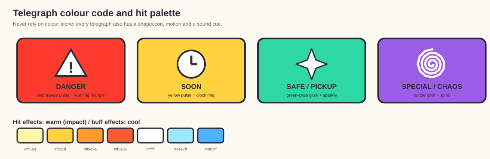
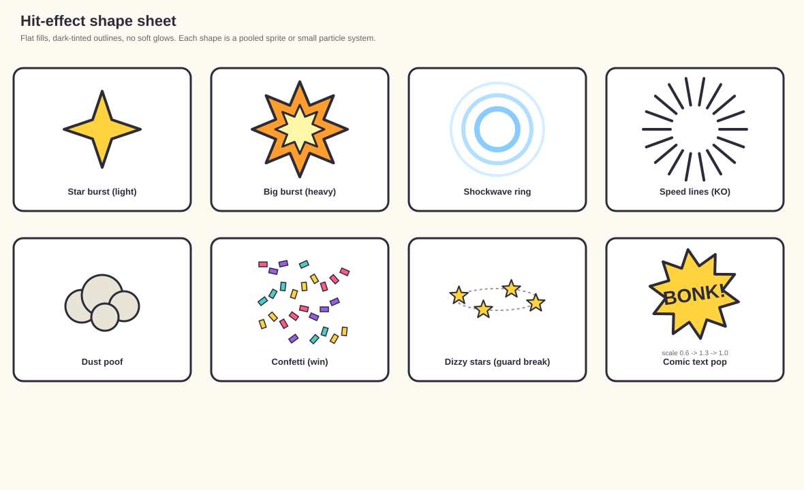
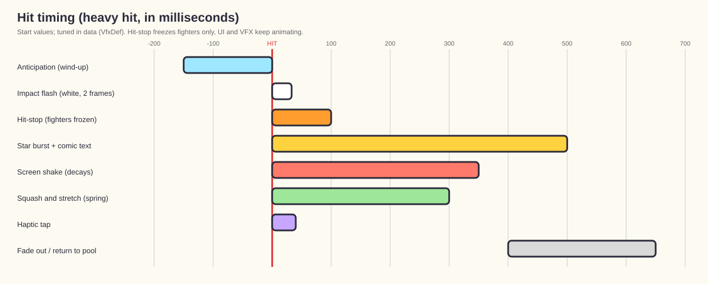

# vfx_style.md — Visual Effects & Game-Feel Style

> Companion to [`PRD.md`](PRD.md) (section 14.2), [`architecture.md`](architecture.md) (sections 6.3, 7, 13, 14) and [`characters.md`](characters.md).
> The "cartoon chaos" direction and the **flat toon shading with outlines** art style are **approved**; the specific effect list, palette and numbers are **[PROPOSED]**. Numbers marked **(start)** are tuning defaults stored in data (`VfxDef`), not in code.
> Target: **Unity 6.3+ with URP**, mobile (Google Play), 60 FPS on a mid-range phone.

## 1. Style Pillars
1. **Cartoon snap.** Effects are exaggerated, graphic and fast: stars, rings, comic text, smears, dust poofs, confetti. Short and punchy, never realistic.
2. **Readable first.** Effects must never hide the fighters or hazard warnings. Gameplay clarity beats spectacle.
3. **Anticipation, impact, settle.** Every big effect follows a three-beat rhythm: a short build-up, a hard hit (with hit-stop), then a quick fade.
4. **Squash and stretch everywhere.** Characters, props and UI pop with elastic motion.
5. **Cheap to render.** Sprite-sheet and simple-mesh particles with unlit shaders, strict particle caps and pooling.

## 2. Visual Language

### 2.1 Palette
- Saturated, cheerful colors on a lighter background. Hit effects are warm (yellow, orange, white); heal/buff effects are cool (cyan, mint).
- **Telegraph color code (hazards and items):** red/orange pulse = danger, yellow = soon, green/cyan = safe or pickup, purple = special/chaos.
- **Player vs opponent** HUD and impact tints may differ slightly but must also differ by shape for color-blind players.

*Generated schematic: telegraph colors with their paired shapes, and the warm/cool hit palette.*

### 2.2 Shapes
- Stars, 4/8-point bursts, rings and shockwave circles, speed lines, "poof" clouds, confetti rectangles, sweat/stress drops, dizzy spirals, hearts for wins.
- Hard-edged shapes with a slightly thick outline, no soft realistic gradients. **Effects must match the game's flat toon + outline style** ([`characters.md`](characters.md) 3.4): flat fills, 2-3 tone bands, dark-tinted outlines, no smooth glows or realistic smoke.
- Particle materials use the toon/unlit look and the same outline color logic where a shape needs an outline (stars, text, rings).

*Generated schematic: the launch shape vocabulary (star bursts, rings, speed lines, dust, confetti, dizzy stars, comic text).*

### 2.3 Comic text
- Onomatopoeia popups: `BONK`, `POW`, `SPLAT`, `BOING`, `HONK`, `FWAP`, `SQUEAK`, `KO!`, `PERFECT`.
- Spawned at the impact point, scale-pop overshoot (0.6 -> 1.3 -> 1.0), slight random rotation (+/- 12 deg), 0.5-0.8 s life, fades with a small upward drift.
- Heavier hits use bigger text and more letters; blocks use `BLOCK`/`CLANG` in a cool color.
- Fonts: the prototype fonts (`Font/`) are sci-fi/gothic and will be **replaced** by a chunky comic font with a clear license **[OPEN]**. Always record the license.

## 3. Effect Catalogue (launch set)
Each effect is a pooled prefab driven by a `VfxDef` and triggered by gameplay **events** (never called directly by combat code; see [`architecture.md`](architecture.md) 6.3). Budgets are per effect instance.

| Id | Trigger event | Description | Duration | Particles (max) |
|---|---|---|---|---|
| `VFX_Hit_Light` | light hit landed | small star burst + short comic text | 0.3 s | 12 |
| `VFX_Hit_Heavy` | heavy hit / combo ender | big star burst, ring shockwave, text, 2-frame white flash | 0.5 s | 24 |
| `VFX_Hit_Special` | special lands | huge burst, screen shake, color-tinted ring | 0.8 s | 40 |
| `VFX_Block` | blocked hit | metallic "clang" spark ring in cool color, small pushback dust | 0.3 s | 10 |
| `VFX_GuardBreak` | guard meter empty | glass-crack ring + dizzy stars above head | 1.0 s (loops while stunned) | 16 |
| `VFX_Dust_Step` | landing, dash, knockdown | small dust poofs at the feet | 0.4 s | 8 |
| `VFX_Squash_Smear` | fast limb movement | stretched smear shape following the limb | 0.15 s | mesh/sprite |
| `VFX_KO` | fighter KO | radial speed lines, big "KO!" text, color desaturation vignette, slow-mo | 1.5 s | 30 |
| `VFX_Win_Confetti` | round/match win | confetti cannon, hearts/stars | 2.0 s | 60 |
| `VFX_Pickup` | item picked up | sparkle ring around the holder + item icon pop | 0.4 s | 12 |
| `VFX_ItemSpawn` | item spawns | falling shadow marker + poof on landing (reuses `SpawnRing`) | 1.5 s | 20 |
| `VFX_Hazard_Telegraph` | hazard warning | pulsing ground decal + icon + sound cue | >= 1.5 s | decal |
| `VFX_Hazard_Active` | hazard active | stage-specific burst (see [`maps.md`](maps.md)) | per hazard | <= 40 |
| `VFX_Pop` | Puffin Pete pops | air burst, flying "psssht" lines, deflate squeak text | 0.8 s | 20 |
| `VFX_Stuffing` | Madame Plush thresholds | cotton puffs from the seam | 0.6 s | 16 |
| `VFX_Taunt` | taunt | small themed emote burst | 0.8 s | 12 |
| `VFX_RoundStart` | round begins | "FIGHT!" text pop + camera zoom-out | 1.0 s | text |

Item-specific effects (banana peel slip, foam glove impact, rubber chicken boink, rocket plunger exhaust, whoopee shockwave, anvil impact) use the same shapes and are listed in the item data.

### 3.1 Intensity scaling
Hit effects scale with `damage / maxDamage` and combo count: bigger burst, more shake and louder SFX. The scaling curve is data (`VfxDef.IntensityCurve`), capped so effects never exceed their particle budget.

## 4. Game Feel Layer

| Technique | Rule (start) |
|---|---|
| **Hit-stop** | freeze both fighters' animation/physics 60-100 ms on hit; 40-60 ms on block; 120 ms on special/KO. Does **not** use global `Time.timeScale`, so UI and VFX keep animating (see [`architecture.md`](architecture.md) 6.3). |
| **Screen shake** | trauma-based, decays fast; light 0.1, heavy 0.25, special 0.4, KO 0.5 of max; **user can reduce or disable** |
| **Slow-mo** | KO only: 0.3x for ~0.6 s, with camera punch-in |
| **Camera punch-in** | FOV nudge or distance change on heavy hits and KO, 0.2 s ease-out |
| **Flash** | 1-2 frame white overlay on heavy hits; never more than 3 flashes per second |
| **Chromatic/vignette** | optional URP volume pulses on KO; disabled on low-end devices |
| **Squash and stretch** | `SquashStretch` component on the visual root: spring to 0.8-1.2 scale on impact, 0.15-0.3 s |
| **Haptics** | light tap on hit, stronger on heavy/KO, none on block; respects the user's haptics setting |

*Generated schematic of the start timings for a heavy hit.*

All of these are triggered by the **same hit event**, so they stay in sync (VFX, SFX, camera, haptics, UI pop).

## 5. Stage and Hazard VFX
- Stage hazards use the telegraph language in section 2.1 and **always warn >= 1.5 s** before becoming dangerous: ground decal + pulsing color + sound cue + (optional) icon.
- A hazard must be understandable **without color alone**: shape/icon plus sound plus motion.
- Ambient stage particles (bubbles, crumbs, dust motes, confetti) are low-count and background-only; they must never overlap the fight plane's visual center.
- Per-stage effect detail is in [`maps.md`](maps.md).

## 6. Technical Rules (URP, mobile)
- **Shaders:** unlit or simple-lit particle shaders; additive and alpha-blended only where needed. No real-time shadows or lights from particles. No grab-pass/refraction. Soft particles off by default.
- **Textures:** sprite-sheet atlases (one atlas for all hit effects, one for comic text), compressed (ASTC). Prefer flipbook animation over many particles.
- **Particle budgets (start):** <= 300 live particles on screen at once; <= 40 per effect instance; per-frame overdraw monitored on a low-end device.
- **Pooling:** all VFX are pooled (`Pool<T>`); no `Instantiate`/`Destroy` in combat. Effects return to the pool via a `OnParticleSystemStopped`/timer.
- **Limits:** a cap on simultaneous same-type effects (for example max 6 hit effects), oldest recycled first.
- **No per-frame allocations** while spawning or updating effects.
- **Quality tiers:** High / Medium / Low settings reduce particle counts, disable chromatic/vignette pulses, and simplify smears.
- **Decals:** simple quad/projector alternatives are preferred over full URP decals if cost is too high on target devices **[VERIFY]**.
- **LODs:** none needed; use the quality tiers instead.

## 7. Data & Naming
- Effects are driven by `VfxDef` ScriptableObjects: `Id`, `Prefab`, `PoolSize`, `MaxInstances`, `IntensityCurve`, `Duration`, `SfxId`, `Shake`, `HitStop`, `Haptic`. A `VfxService` maps events to `VfxDef`s; no direct references from combat code.
- Prefabs: `VFX_<Category>_<Name>` (for example `VFX_Hit_Heavy`), stored in `Art/VFX/`.
- Textures: `VFX_<Name>_Atlas`. Materials: `VFX_<Name>_Mat`.
- Source particle setups and shaders are reviewed against [`coding_guidelines.md`](coding_guidelines.md) section 5 (performance).

## 8. Reusing the Prototype's Effects
The repo already has `Explosion`, `HitEffect_A`, `HitEffect_B`, `Sparks`, `Smoke` and `SpawnRing` prefabs (`VFX/`, `prefabs/`).
- **Keep as base:** `HitEffect_A/B` (starting point for light/heavy hit), `SpawnRing` (item spawn marker), `Explosion` (heavy/anvil impact, after re-skinning).
- **Re-skin or replace:** realistic sparks and smoke become star bursts and dust poofs.
- Convert materials to **URP** (task M0-04) and set up the toon/outline shader (task M0-18) before changing the look.

## 9. Accessibility & Safety
- **Reduce motion/shake** toggle in settings: lowers shake, flash and slow-mo.
- **Photosensitivity:** no more than 3 flashes per second, no high-contrast full-screen strobing.
- Telegraphs use shape, motion and sound as well as color.
- Comic text is large and high-contrast; offered in the game's language set later.

## 10. Production Checklist (per effect)
1. Reference sketch and timing (anticipation, impact, settle)
2. Sprite sheet or mesh created and compressed
3. Particle system built within the budget; tested on a low-end device
4. Added to the pool and bound to a `VfxDef` and event (no direct calls)
5. Synced with SFX, shake, hit-stop and haptics
6. Verified: no allocations, no overdraw spikes, readable on a small screen

## Reference images
The three diagrams above are generated by `python3 Tools/docs_art/make_diagrams.py` (colors, shape vocabulary, timing). Update the generator when those values change in this doc.

**Ready-to-use prompts for generating this art are in [`art_prompts.md`](art_prompts.md).** **Reference art is provided by the owner** (task D-11). Put each file in `docs/images/vfx/concept/` and link it here once it exists (the docs link check fails on missing files). Suggested set:

| File | What it should show |
|---|---|
| [`hit_light_heavy_frames.png`](images/vfx/concept/hit_light_heavy_frames.png) | frame-by-frame sketches of the light and heavy hit effects (anticipation, impact, settle) |
| [`comic_text_samples.png`](images/vfx/concept/comic_text_samples.png) | the chosen comic font and 6-9 onomatopoeia samples with outlines |
| [`ko_sequence.png`](images/vfx/concept/ko_sequence.png) | key frames of the KO effect (speed lines, text, slow-mo, vignette) |
| [`hazard_telegraph_examples.png`](images/vfx/concept/hazard_telegraph_examples.png) | one telegraph mock-up per stage hazard (decal, icon, color) |
| `moodboard.png` | 6-12 references for the cartoon-chaos effect style |

Rules: record sources and licenses (`SOURCES.md`), save them as PNG at least 2048 px wide, and keep each file under about 5 MB (they are stored directly in the repo, not in Git LFS).

## 11. Decisions & Open Questions

**Decided by the owner:** shading is flat toon with outlines ([`characters.md`](characters.md) 3.4). Effects follow the same style.

**Still open [OPEN]:**
1. Comic font choice and license.
2. Should the screen-space comic text be localized, or stay universal?
3. Which post-processing (URP volume) effects are allowed on the lowest tier?
