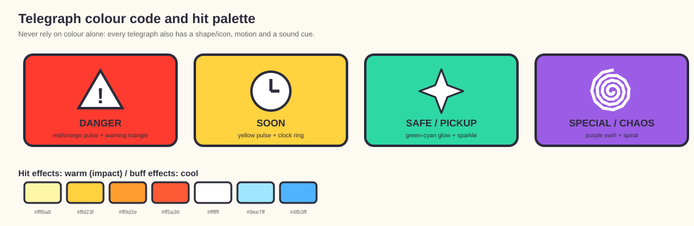
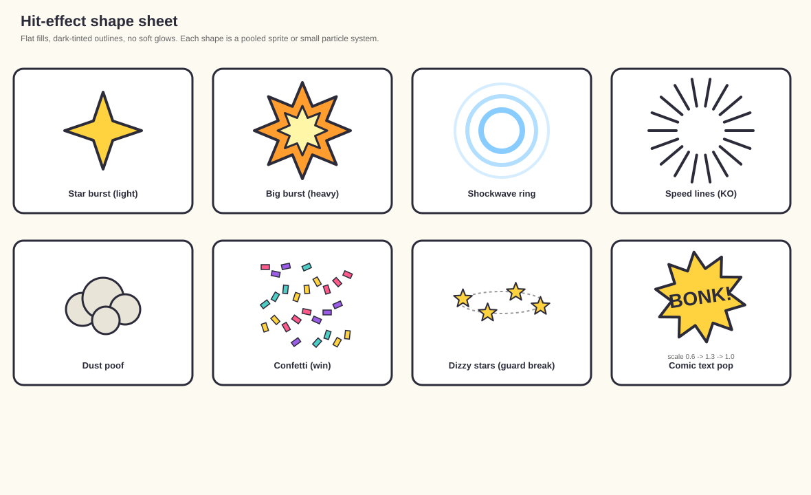
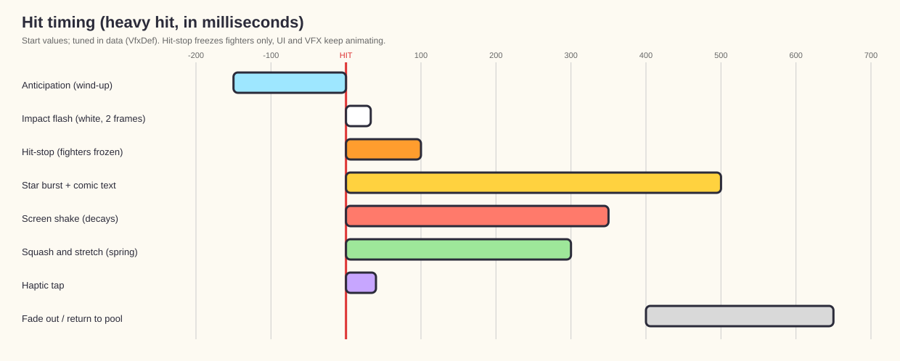
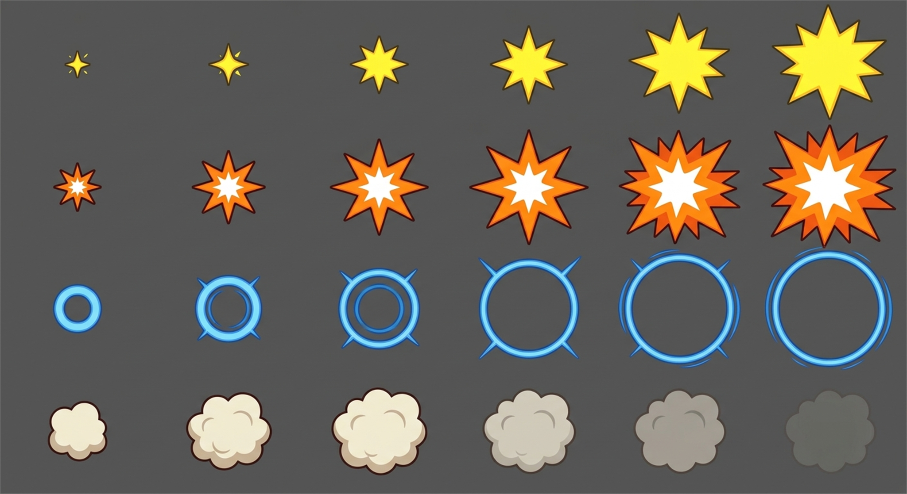
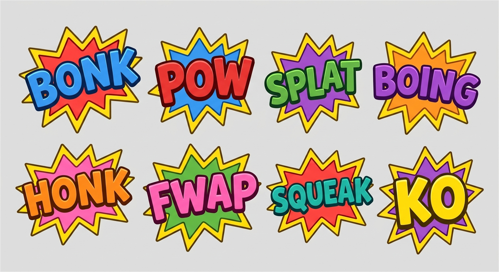
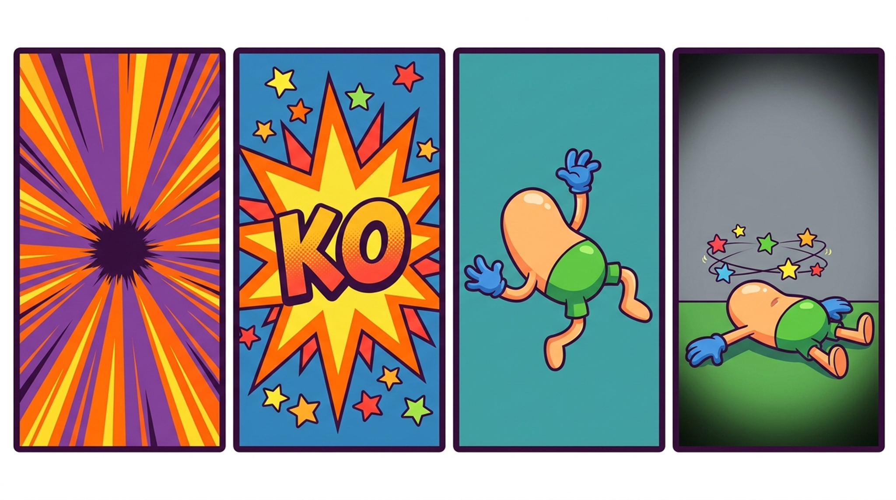
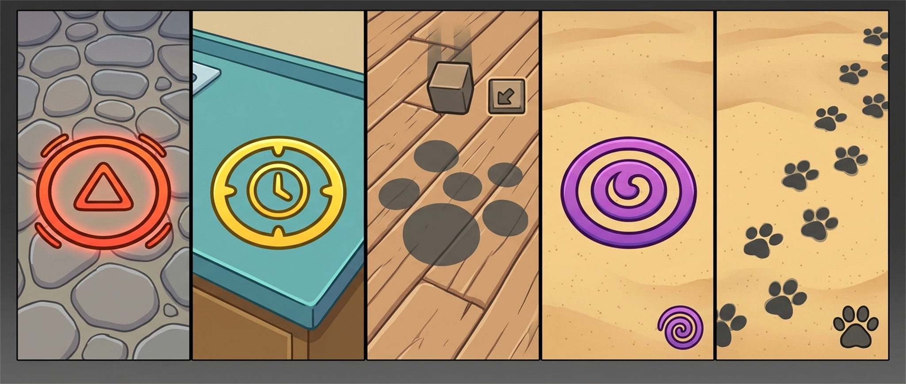

# vfx_style.md — Visual Effects & Game-Feel Style

> Companion to [`PRD.md`](PRD.md) (section 14.2), [`architecture.md`](architecture.md) (sections 6.3, 7, 13, 14) and [`characters.md`](characters.md).
> The "cartoon chaos" direction and the **flat toon shading with outlines** art style are **approved**; the specific effect list, palette and numbers are **[PROPOSED]**. Numbers marked **(start)** are tuning defaults stored in data (`VfxDef`), not in code.
> Target: **Unity 6.3+ with URP**, mobile (Google Play), 60 FPS on a mid-range phone.

## 1. Style Pillars
1. **Cartoon snap.** Effects are exaggerated, graphic and fast: stars, rings, comic text, smears, dust poofs, confetti. Short and punchy, never realistic.
2. **Readable first.** Effects must never hide the fighters or hazard warnings. Gameplay clarity beats spectacle.
3. **Anticipation, impact, settle.** Every big effect follows a three-beat rhythm: a short build-up, a hard hit (with hit-stop), then a quick fade.
4. **Squash and stretch everywhere.** Characters, props and UI pop with elastic motion.
5. **Cheap to render.** Sprite-sheet and simple-mesh particles with unlit shaders, strict particle caps and pooling.

## 2. Visual Language

### 2.1 Palette
- Saturated, cheerful colors on a lighter background. Hit effects are warm (yellow, orange, white); heal/buff effects are cool (cyan, mint).
- **Telegraph color code (hazards and items):** red/orange pulse = danger, yellow = soon, green/cyan = safe or pickup, purple = special/chaos.
- **Player vs opponent** HUD and impact tints may differ slightly but must also differ by shape for color-blind players.

*Generated schematic: telegraph colors with their paired shapes, and the warm/cool hit palette.*

### 2.2 Shapes
- Stars, 4/8-point bursts, rings and shockwave circles, speed lines, "poof" clouds, confetti rectangles, sweat/stress drops, dizzy spirals, hearts for wins.
- Hard-edged shapes with a slightly thick outline, no soft realistic gradients. **Effects must match the game's flat toon + outline style** ([`characters.md`](characters.md) 3.4): flat fills, 2-3 tone bands, dark-tinted outlines, no smooth glows or realistic smoke.
- Particle materials use the toon/unlit look and the same outline color logic where a shape needs an outline (stars, text, rings).

*Generated schematic: the launch shape vocabulary (star bursts, rings, speed lines, dust, confetti, dizzy stars, comic text).*

### 2.3 Comic text

M2-06 applies six event-driven cues in CombatSandbox, Bathtub Brawl, and Kitchen Counter. BONK uses a small yellow burst, POW uses a larger orange burst and ring, KABOOM uses a violet special burst, CLANG uses a cool segmented ring, CRACK uses uneven violet shards, and KO uses radial speed lines. Heavy and special bursts flash white briefly. One label and burst graphic per fighter are reused, with scale-pop and fade driven by unscaled time. The palette is in `CombatImpactPalette.json`.
- Onomatopoeia popups: `BONK`, `POW`, `SPLAT`, `BOING`, `HONK`, `FWAP`, `SQUEAK`, `KO!`, `PERFECT`.
- Spawned at the impact point, scale-pop overshoot (0.6 -> 1.3 -> 1.0), slight random rotation (+/- 12 deg), 0.5-0.8 s life, fades with a small upward drift.
- Heavier hits use bigger text and more letters; blocks use `BLOCK`/`CLANG` in a cool color.
- Fonts: the prototype fonts (`Font/`) are sci-fi/gothic and will be **replaced** by a chunky comic font with a clear license **[OPEN]**. Always record the license.

## 3. Effect Catalogue (launch set)
Each effect is a pooled prefab driven by a `VfxDef` and triggered by gameplay **events** (never called directly by combat code; see [`architecture.md`](architecture.md) 6.3). Budgets are per effect instance.

| Id | Trigger event | Description | Duration | Particles (max) |
|---|---|---|---|---|
| `VFX_Hit_Light` | light hit landed | small star burst + short comic text | 0.3 s | 12 |
| `VFX_Hit_Heavy` | heavy hit / combo ender | big star burst, ring shockwave, text, 2-frame white flash | 0.5 s | 24 |
| `VFX_Hit_Special` | special lands | huge burst, screen shake, color-tinted ring | 0.8 s | 40 |
| `VFX_Block` | blocked hit | metallic "clang" spark ring in cool color, small pushback dust | 0.3 s | 10 |
| `VFX_GuardBreak` | guard meter empty | glass-crack ring + dizzy stars above head | 1.0 s (loops while stunned) | 16 |
| `VFX_Dust_Step` | landing, dash, knockdown | small dust poofs at the feet | 0.4 s | 8 |
| `VFX_Squash_Smear` | fast limb movement | stretched smear shape following the limb | 0.15 s | mesh/sprite |
| `VFX_KO` | fighter KO | radial speed lines, big "KO!" text, color desaturation vignette, slow-mo | 1.5 s | 30 |
| `VFX_Win_Confetti` | round/match win | confetti cannon, hearts/stars | 2.0 s | 60 |
| `VFX_Pickup` | item picked up | sparkle ring around the holder + item icon pop | 0.4 s | 12 |
| `VFX_ItemSpawn` | item spawns | falling shadow marker + poof on landing (reuses `SpawnRing`) | 1.5 s | 20 |
| `VFX_Hazard_Telegraph` | hazard warning | pulsing ground decal + icon + sound cue | >= 1.5 s | decal |
| `VFX_Hazard_Active` | hazard active | stage-specific burst (see [`maps.md`](maps.md)) | per hazard | <= 40 |
| `VFX_Pop` | Puffin Pete pops | twenty pale-blue air streaks, PSSSHT! impact text, original hiss cue and flattened body morph | 0.8 s | 20 |
| `VFX_Stuffing` | Madame Plush thresholds | cream cotton mesh puffs, persistent seam morph, original cloth creak | 0.6 s | 16 |
| `VFX_Taunt` | taunt | small themed emote burst | 0.8 s | 12 |
| `VFX_RoundStart` | round begins | "FIGHT!" text pop + camera zoom-out | 1.0 s | text |

Item-specific effects (banana peel slip, foam glove impact, rubber chicken boink, rocket plunger exhaust, whoopee shockwave, anvil impact) use the same shapes and are listed in the item data.

### 3.1 Intensity scaling
Hit effects scale with `damage / maxDamage` and combo count: bigger burst, more shake and louder SFX. The scaling curve is data (`VfxDef.IntensityCurve`), capped so effects never exceed their particle budget.

## 4. Game Feel Layer

| Technique | Rule (start) |
|---|---|
| **Hit-stop** | freeze both fighters' animation/physics 60-100 ms on hit; 40-60 ms on block; 120 ms on special/KO. Does **not** use global `Time.timeScale`, so UI and VFX keep animating (see [`architecture.md`](architecture.md) 6.3). |
| **Screen shake** | trauma-based, decays fast; light 0.1, heavy 0.25, special 0.4, KO 0.5 of max; **user can reduce or disable** |
| **Slow-mo** | KO only: 0.3x for ~0.6 s, with camera punch-in |
| **Camera punch-in** | FOV nudge or distance change on heavy hits and KO, 0.2 s ease-out |
| **Flash** | 1-2 frame white overlay on heavy hits; never more than 3 flashes per second |
| **Chromatic/vignette** | optional URP volume pulses on KO; disabled on low-end devices |
| **Squash and stretch** | `SquashStretch` component on the visual root: spring to 0.8-1.2 scale on impact, 0.15-0.3 s |
| **Haptics** | light tap on hit, stronger on heavy/KO, none on block; respects the user's haptics setting |

Sir Noodle reuses the shared comic impacts and KO presentation. His CharacterDef sets partial-ragdoll reaction strength to 1.25 and duration to 0.6 s for the floppier noodle rig; intermediate bend bones remain visual. Helicopter Joust's four alternating hit windows use 3 hit-stop frames each. The imported visual uses the shared toon graph with its original pink/blue atlas and a dark-purple outline (width 0.009). No separate particle or voice content is added by M4-01.

Puffin Pete uses the shared toon graph with his blue/white/orange atlas and navy outline (width 0.012). Inflate and Deflate morphs blend at 400 weight units/s and pause with fighter hit-stop. Blocking Inflate targets 100 weight; Belly Blimp targets 150; Deflate targets 100 while popped. Inflated survivors suppress the ordinary partial-ragdoll response; normal reactions use strength 0.65 and 0.28 s duration. Pop pressure has its own HUD bar. Round boundaries reset morph weights and stop/clear air particles and audio. `PetePop.wav` is an original deterministic noise/chirp cue generated by Tools/Audio/generate_pete_pop.py; no recording was sampled. Final voice and wider audio polish remain M4-09.

*Generated schematic of the start timings for a heavy hit.*

All of these are triggered by the **same hit event**, so they stay in sync (VFX, SFX, camera, haptics, UI pop).

## 5. Stage and Hazard VFX
- Stage hazards use the telegraph language in section 2.1 and **always warn >= 1.5 s** before becoming dangerous: ground decal + pulsing color + sound cue + (optional) icon.
- A hazard must be understandable **without color alone**: shape/icon plus sound plus motion.
- Ambient stage particles (bubbles, crumbs, dust motes, confetti) are low-count and background-only; they must never overlap the fight plane's visual center.
- Per-stage effect detail is in [`maps.md`](maps.md).
- Bouncy Castle Fair reuses four outlined yellow arrow meshes: upward arrows over the two pads and inward arrows attached to moving walls. Pad warning arrows pulse in scale at 1.5 Hz; wall visuals bulge by up to 5% during their two-second warning. Chime and pump/creak cues provide non-color warnings; each actual pad bounce has a boing. All warning objects are reused, with no hazard particles, extra lights or per-frame allocations. Inactive/cooldown hides warnings, round end also stops audio and restores wall scale. Scenery uses one palette atlas, the shared opaque toon graph and a dark navy outline (0.025 width). Original music and low-volume ambience support the fairground mood.
- Giant Sandbox reuses four authored hazard meshes: a soft cream/pink cat paw, a flat paw shadow, edge whiskers and a low sand spiral. Paw warnings combine a creeping shadow, 1.5 Hz whisker twitch and purr; sand warnings use a 1.5 Hz scale pulse and swirl cue. Active sand rotates at 90 degrees/s; the paw crosses over three seconds with a soft hit thump. No claws, gore or hazard particles. Up to twelve tiny mesh sand motes remain in the background. Toon atlas/outline match the scenery. Round end/sudden death/Hazards Off hide hazard meshes and stop their SFX; ambient motes remain decorative. All meshes/effects are reused and time-scaled motion pauses normally.

## 6. Technical Rules (URP, mobile)
- **Shaders:** unlit or simple-lit particle shaders; additive and alpha-blended only where needed. No real-time shadows or lights from particles. No grab-pass/refraction. Soft particles off by default.
- **Textures:** sprite-sheet atlases (one atlas for all hit effects, one for comic text), compressed (ASTC). Prefer flipbook animation over many particles.
- **Particle budgets (start):** <= 300 live particles on screen at once; <= 40 per effect instance; per-frame overdraw monitored on a low-end device.
- **Pooling:** all VFX are pooled (`Pool<T>`); no `Instantiate`/`Destroy` in combat. Effects return to the pool via a `OnParticleSystemStopped`/timer.
- **Limits:** a cap on simultaneous same-type effects (for example max 6 hit effects), oldest recycled first.
- **No per-frame allocations** while spawning or updating effects.
- **Quality tiers:** High / Medium / Low settings reduce particle counts, disable chromatic/vignette pulses, and simplify smears.
- **Decals:** simple quad/projector alternatives are preferred over full URP decals if cost is too high on target devices **[VERIFY]**.
- **LODs:** none needed; use the quality tiers instead.

## 7. Data & Naming
- Effects are driven by `VfxDef` ScriptableObjects: `Id`, `Prefab`, `PoolSize`, `MaxInstances`, `IntensityCurve`, `Duration`, `SfxId`, `Shake`, `HitStop`, `Haptic`. A `VfxService` maps events to `VfxDef`s; no direct references from combat code.
- Prefabs: `VFX_<Category>_<Name>` (for example `VFX_Hit_Heavy`), stored in `Art/VFX/`.
- Textures: `VFX_<Name>_Atlas`. Materials: `VFX_<Name>_Mat`.
- Source particle setups and shaders are reviewed against [`coding_guidelines.md`](coding_guidelines.md) section 5 (performance).

## 8. Reusing the Prototype's Effects
The repo already has `Explosion`, `HitEffect_A`, `HitEffect_B`, `Sparks`, `Smoke` and `SpawnRing` prefabs (`VFX/`, `prefabs/`).
- **Keep as base:** `HitEffect_A/B` (starting point for light/heavy hit), `SpawnRing` (item spawn marker), `Explosion` (heavy/anvil impact, after re-skinning).
- **Re-skin or replace:** realistic sparks and smoke become star bursts and dust poofs.
- Convert materials to **URP** (task M0-04) and set up the toon/outline shader (task M0-18) before changing the look.

## 9. Accessibility & Safety
- **Reduce motion/shake** toggle in settings: lowers shake, flash and slow-mo.
- **Photosensitivity:** no more than 3 flashes per second, no high-contrast full-screen strobing.
- Telegraphs use shape, motion and sound as well as color.
- Comic text is large and high-contrast; offered in the game's language set later.

## 10. Production Checklist (per effect)
1. Reference sketch and timing (anticipation, impact, settle)
2. Sprite sheet or mesh created and compressed
3. Particle system built within the budget; tested on a low-end device
4. Added to the pool and bound to a `VfxDef` and event (no direct calls)
5. Synced with SFX, shake, hit-stop and haptics
6. Verified: no allocations, no overdraw spikes, readable on a small screen

## Reference images
The three diagrams above are generated by `python3 Tools/docs_art/make_diagrams.py` (colors, shape vocabulary, timing). Update the generator when those values change in this doc.

**Ready-to-use prompts for generating this art are in [`art_prompts.md`](art_prompts.md).** **Reference art is provided by the owner** (task D-11) and lives in `docs/images/vfx/concept/`. Provenance for every image is in [`SOURCES.md`](images/vfx/concept/SOURCES.md). Core set (checked by `Tools/tasks/check_concept_art.py`):

### Light and heavy hit effect frames
Frame-by-frame sketches of the light and heavy hit effects (anticipation, impact, settle). File: [`hit_light_heavy_frames.png`](images/vfx/concept/hit_light_heavy_frames.png).

### Comic text samples
The chosen comic font and 6-9 onomatopoeia samples with outlines. File: [`comic_text_samples.png`](images/vfx/concept/comic_text_samples.png).

### KO sequence
Key frames of the KO effect (speed lines, text, slow-mo, vignette). File: [`ko_sequence.png`](images/vfx/concept/ko_sequence.png).

### Hazard telegraph examples
One telegraph mock-up per stage hazard (decal, icon, color). File: [`hazard_telegraph_examples.png`](images/vfx/concept/hazard_telegraph_examples.png).

Optional extra, **not yet supplied**: `moodboard.png` (6-12 references for the cartoon-chaos effect style).

Rules: record sources and licenses (`SOURCES.md`), save them as PNG at least 2048 px wide, and keep each file under about 5 MB (they are stored directly in the repo, not in Git LFS).

## 11. Decisions & Open Questions

**Decided by the owner:** shading is flat toon with outlines ([`characters.md`](characters.md) 3.4). Effects follow the same style.

**Still open [OPEN]:**
1. Comic font choice and license.
2. Should the screen-space comic text be localized, or stay universal?
3. Which post-processing (URP volume) effects are allowed on the lowest tier?

### M1 impact feedback wiring

Attach `SquashStretch` to a fighter and assign its visual child. Attach `ComicImpactPopup` to a screen-space overlay Canvas and assign the fighter, camera, and a dedicated text label. Both components subscribe to the shared fighter hit event and use unscaled time.

### M1 knockout presentation

CombatSandbox wires both Fighter knockout events to `KnockoutPresentation`. It applies 1.4 seconds of unscaled presentation at 35% game speed and holds the orthographic camera at 62% of its normal size near the midpoint and pans toward the defeated fighter. The component restores the original camera and time scale on completion or disable. Ragdoll integration remains tracked separately.

Blobby uses the URP ToonJellySurface Shader Graph for two lighting bands and a view-dependent rim. A front-culled inverted hull draws the outline at 0.018 m. Setting Outline Width to zero disables the visible outline. The owner verified the previous material. The replacement graph and separate outline material were imported and assigned to the shared prefab. The replacement needs a Game view check.

### Madame Plush feedback (M4-03)

The shared toon graph uses a brown cloth atlas and dark brown outline (width 0.012). Stuffing75/50/25 independently open seams at 75/50/25% health, blending at 500 weight units/s and pausing during hit-stop. Seams remain revealed until round reset. Each new threshold event emits one burst of at most sixteen cream cotton octahedra for 0.6 s from the highest newly crossed seam; crossing several at once still emits only sixteen. No blood. Round boundaries clear particles/audio; full-health reset closes all seams. Ordinary partial-ragdoll response uses strength 0.85 and duration 0.4 s.

`PlushCreak.wav` (0.25 s cloth noise) and `PlushWinBell.wav` (0.6 s sweet bell) are original deterministic synthesis from `Tools/Audio/generate_plush_cues.py`, with no sampled recording. Both respect SFX settings. A TOUGH! guard caption identifies the current low-health bonus. Final voice barks and broader sound polish remain M4-09. See [source and provenance](../Art/_Source/MadamePlush/README.md).

## Additional pickup feedback (M4-06)

The six new pickups share a 1024 palette atlas, the existing opaque toon graph and a dark outline (0.012 width); source geometry totals 8,696 triangles. Cream/cherry pie, V boomerang, spring pogo, colored wand, wind-up car and boxing jack have distinct silhouettes. The boomerang spins at 540 degrees/s during flight. The bubble alone uses the existing transparent toon surface at cyan alpha 0.22, expands around its captured fighter and follows it until release. The HUD shows BUBBLED! or SLOWED without allocating status labels per frame. A boxing jack pulses its reusable yellow ring for 90 frames (about 1.8 s), stretches its spring/glove over a 12-frame punch and then recycles. No additional particles or real-time lights. Model scales/rotations/visibility reset on pool return; active status and bubble ownership clear at round boundaries. Six original short toy SFX use AudioManager's existing pool and SFX volume. [Complete item data](items.md) and [source provenance](../Art/_Source/NoveltyItems/provenance.json) record the implementation.

Training-only item displays remain visible in CombatSandbox while separate usable copies perform their normal motion/effects and expire/recycle. This does not alter rendering or lifetime behavior of actual arena pickups. The extended floor/camera frames all twelve slots; KO framing still takes priority during round transitions.

Mr. Jack uses the shared toon graph with a purple outline and the jester reference palette. Four spring joints add a bounded velocity-follow bend (2.5 degrees per m/s, total ±12 degrees, .12 s smoothing). Surprise uses an orange 32-point floor ring and a 1.5 s music-box warning; the ring fixes the target at startup and clears on interruption/reset. The lid-slam hit window shows a low 1.6 m-radius ring for readability. Phase ejection extends the spring with its authored clip; hit-stop/pause freeze visual spring updates and KO yields to physics. The approved short laugh plays on attacks with a two-second throttle, and phase/win events force one bark. Sources follow existing SFX volume and pause settings; final voice-bus/mix pass remains M4-09.

Toy Chest Showdown uses growing amber floor markers and a synthesized rattle for Block Rain, and an amber direction arrow, creak and slowed music for Music Box Tilt. Both warnings last two seconds. The stage music and cues are original procedural audio.

The final audio mix gives announcer calls priority over fighter barks and briefly ducks music. Short impacts have slight pitch variation, while warning sounds keep their authored timing. Voice, music, and SFX have separate gain controls.
